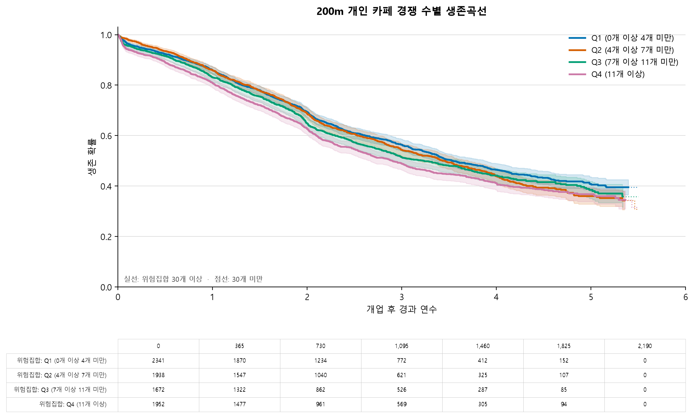
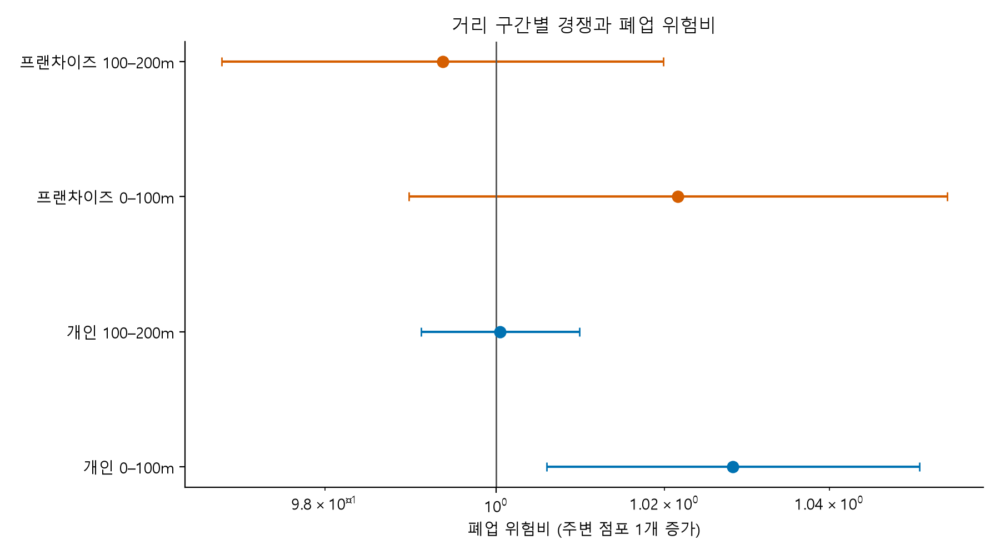
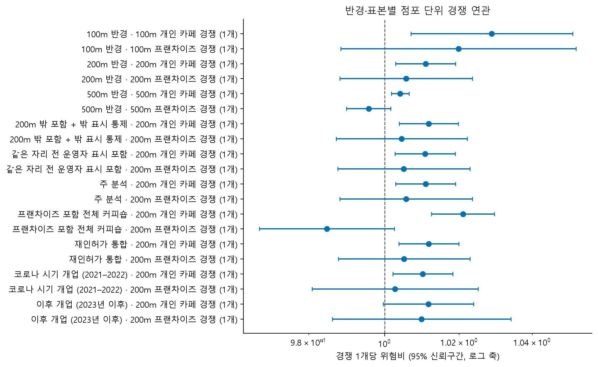
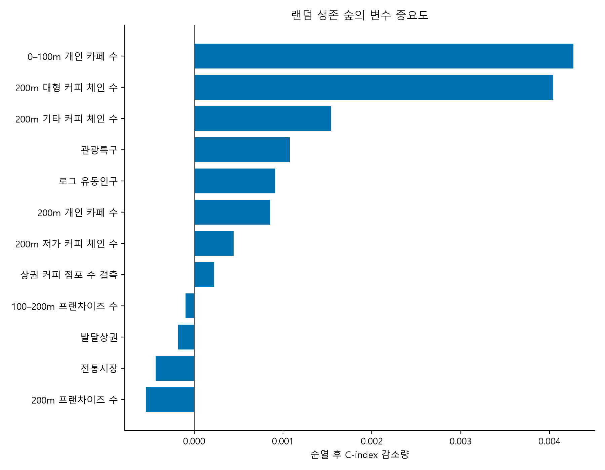

# 서울 카페 생존 분석: 바로 옆 경쟁이 폐업 위험을 좌우하는가

서울시 휴게음식점 인허가 자료로 개인 카페 하나하나의 개업부터 폐업까지 기간을 추적하고, 개업 입지와 주변 경쟁 환경이 폐업 위험과 어떻게 연관되는지 분석한 프로젝트다.

> **질문:** 서울 카페는 왜 어떤 곳은 살아남고 어떤 곳은 문을 닫는가?
> 공공 상권 정보가 주는 상권 단위 평균(점포 수·매출·유동인구) 외에, **점포 바로 주변의 경쟁**이 폐업 위험을 더 설명하는가? 유동인구가 많은 곳에서는 경쟁의 영향이 상쇄되는가?

## 핵심 결과

| 발견 | 근거 |
|---|---|
| **주변 개인 카페가 많을수록 폐업 위험이 높다** | 개업 당시 200m 안 개인 카페 1곳당 위험비 1.011 (95% CI 1.003–1.019). 반경(100·500m), 표본(프랜차이즈 포함·재인허가 통합·상권 밖 점포 포함), 분기별 시변 모형, 2015년 개업까지 넓힌 표본(19,276곳)에서 모두 유지 |
| **영향은 '바로 옆' 100m 안에 몰려 있다** | 0–100m 개인 카페 1곳당 +2.8%, 100–200m는 0에 가깝다. 반경을 넓힐수록 1곳당 효과가 작아짐(100m 2.9% → 200m 1.1% → 500m 0.4%) |
| **프랜차이즈 근처를 피해야 한다는 근거는 없다** | 프랜차이즈 수는 어느 유형(저가·대형·음료·디저트)에서도 뚜렷한 연관이 없음. 확장 표본에서 최악의 경우도 개인 카페 1곳보다 작은 영향. 같은 건물(10m 이내)에 함께 있는 경우만 주의 신호 |
| **상권 매출·유동인구는 폐업 위험과 뚜렷한 연관이 없다** | 수요를 넣기 전후 경쟁 계수 변화 +0.1%(가려짐 근거 없음). 유동인구가 높은 곳에서 경쟁 연관이 약해지는 방향(상호작용 0.990, p=0.024)은 있으나 시변 모형에서 약해짐(p=0.094) |
| **입지만으로는 폐업을 거의 맞히지 못한다** | 상권 단위 교차검증 C-index: Cox 0.514, 랜덤 생존 숲 0.503, XGBoost 0.504 (개업 연도만 0.500). '개업 2년 안 폐업' 분류(5,737곳, 폐업 33.4%)에서도 가장 나은 XGBoost의 ROC-AUC 0.519, 정밀도 0.34로 무작위 예측(0.33)과 비슷. 그래도 생존 모형의 중요 변수 1위는 0–100m 개인 카페 수, 분류 모형 1위는 200m 개인 카페 수 |

**시사점.** 예비 창업자는 상권 평균보다 내 자리 100m 안 개인 카페 수를 직접 확인하는 것이 낫다. 공공 창업 정보 서비스는 상권 단위 지표에 점포 반경 근접 경쟁 지표를 더할 필요가 있다. 다만 입지가 설명하는 몫은 작고, 생존은 운영·메뉴·자금 같은 자료에 없는 요인이 더 크게 좌우한다. 모든 결과는 인과가 아닌 연관이다.

<p align="center">
  
  
</p>
<p align="center">
  
  
</p>

## 데이터

| 용도 | 데이터 | 출처 |
|---|---|---|
| 점포별 개업·폐업일, 좌표, 면적 | 서울시 휴게음식점 인허가 정보 | [서울 열린데이터광장](https://data.seoul.go.kr) |
| 상권 매출, 점포 수, 길단위 유동인구, 상주인구 (2021Q1~) | 서울시 상권분석서비스 | 서울 열린데이터광장 |
| 상권 경계 | 상권분석서비스 영역(SHP) | 서울 열린데이터광장 |
| 상권 임대료 (보조 분석) | 상업용부동산 임대동향 지역별 임대료 | 한국부동산원 R-ONE |

원본 데이터는 용량 때문에 저장소에 넣지 않았다. 위 출처에서 내려받아 `data/raw/<카테고리>/`(`refreshment_establishment`, `estimated_sales`, `store`, `population_by_street`, `resident_population`, `area`, `rent`)에 두면 된다. CSV는 CP949 인코딩이다.

## 분석 설계

- **분석 단위:** 인허가(운영자). 업태가 '커피숍'인 점포 중 프랜차이즈를 뺀 개인 카페
- **주 표본:** 2021년 2분기~2026년 1분기 개업, 가장 가까운 상권이 200m 안에 있는 개인 카페 7,351곳(폐업 3,411건). 관측 종료일 2026-09-30, 그때까지 영업 중이면 중도절단
- **표본 정리:** 한시적 인허가, 생존기간 0일 이하, 카페가 아닌 업종(편의점·보드게임카페 등) 제외. 프랜차이즈는 상호 사전(182개 브랜드)으로 판별해 분석 대상에서는 빼고 경쟁 점포 수에는 넣음
- **변수:** 개업 시점의 반경 200m 개인 카페 수·프랜차이즈 수(경쟁), 개업 직전 분기 상권 총매출·유동인구·상주인구(수요), 상권 구분, 점포 면적
- **방법**
  1. Kaplan–Meier 생존곡선으로 탐색
  2. **Cox 비례위험 모형**(개업 연도 층화, 상권 군집 강건 표준오차)으로 경쟁·수요·상쇄 검증. 상쇄는 두 가지로 봄: 수요를 넣기 전후 경쟁 계수 비교(가려짐), 경쟁×수요 상호작용(완충)
  3. **강건성 검증:** 반경 100·500m, 프랜차이즈 포함 표본, 재인허가 통합 표본, 분기별 시변 Cox, R-ONE 임대료 보조 분석, 2015년 개업까지 확장한 표본, 프랜차이즈 유형·거리 분해
  4. **머신러닝:** 랜덤 생존 숲, XGBoost 생존 모형(SHAP 해석), 개업 2년 안 폐업 여부 분류 모형 비교(로지스틱 회귀·의사결정나무·랜덤 포레스트·XGBoost). 같은 상권 점포가 학습·평가에 나뉘지 않도록 상권 단위 5겹 교차검증

## 저장소 구조

```
src/                 분석 스크립트 (단계 번호 순서로 실행)
docs/reports/        단계별 결과 보고서 (발견 내용 먼저, 방법은 뒤)
docs/figures/        그림 (목록: docs/figures/README.md)
docs/tables/         결과 표 (CSV)
docs/logs/           실행 로그
docs/review/         수작업 검수 파일 (프랜차이즈 판별, 임대료 상권 대응)
prompts/             단계별 분석 작업 지시문
data/                원본·가공 데이터 (저장소 미포함)
```

## 실행 방법

Python 3.13, Windows PowerShell 기준.

```powershell
python -m venv .venv
.venv\Scripts\pip install -r requirements.txt
# scikit-survival은 의존 패키지 ecos가 빌드되지 않아 의존성 없이 따로 설치한다 (ecos가 필요한 모형은 쓰지 않음)
.venv\Scripts\pip install --no-deps scikit-survival osqp numexpr
```

스크립트는 앞 단계 산출물(`data/processed/`)을 읽으므로 아래 순서로 실행한다.

| 순서 | 스크립트 | 내용 |
|---|---|---|
| 1 | `src/02_preprocess.py` | 인허가 정리, 카페·프랜차이즈 판별, 표본 제외 |
| 2 | `src/03_spatial_join.py` | 좌표 변환, 상권 결합, 반경별 경쟁 점포 수 |
| 3 | `src/03_trade_area_variables.py` | 개업 직전 분기 상권 변수 결합 |
| 4 | `src/03_robustness_and_correlation.py` | 재인허가 통합 표본, 공변량 상관·VIF |
| 5 | `src/04_kaplan_meier.py` | 생존곡선 |
| 6 | `src/05_cox.py` | Cox 주 분석 |
| 7 | `src/05_cox_robustness.py`, `src/05_cox_time_split.py`, `src/05_cox_franchise_types.py` | 강건성, 개업 첫해·이후, 프랜차이즈 유형·거리 |
| 8 | `src/06_time_varying_panel.py` → `src/06_time_varying_cox.py` | 분기별 시변 패널과 시변 Cox, 임대료 |
| 9 | `src/07_extended_period.py` | 2015년 이후 개업 확장 표본 |
| 10 | `src/08_survival_ml.py`, `src/08_closure_classification.py` | 생존 머신러닝, 2년 폐업 분류 |

난수 시드는 고정되어 있어 같은 입력이면 같은 결과가 나온다.

## 한계

- 점포별 임대료 자료가 없다. 인허가 월세액은 전부 0이고, R-ONE은 큰 상권 약 70곳의 평균이라 개인 카페 절반에만 붙일 수 있었다.
- 메뉴·가격·자본·운영 경험 같은 점포 내부 요인은 자료가 없다.
- 상권 매출 자료가 2021년부터라 코로나 이전 개업 표본에는 수요 변수를 넣지 못했다.
- 폐업은 인허가 폐업일 기준이라 양도(주인 변경)도 기존 운영자의 폐업으로 본다.
- 관찰 자료이므로 인과가 아닌 연관으로 해석한다.

## 작업 방식

데이터 분석 과제(2026년 2학기)로 수행했다. 연구 질문·정의·표본 기준 같은 결과가 달라지는 결정은 직접 내렸고, 생성형 AI를 다음과 같이 활용했다.

- **Claude (Anthropic):** 분석 설계 논의, 단계별 작업 지시문(`prompts/`) 작성, 결과 검토와 수정 지시, 일부 코드 작성
- **Codex (OpenAI):** 지시문에 따른 전처리·분석·시각화 코드 작성과 실행
