# 서울 카페는 왜 어떤 곳은 살아남고 어떤 곳은 문을 닫는가

## 개업 입지와 주변 경쟁 환경이 개인 카페 생존에 미치는 영향

데이터 분석 기말 프로젝트 보고서 · 2026년 12월

# 요약

서울시 휴게음식점 인허가 자료로 2021년 2분기부터 2026년 1분기 사이에 문을 연 개인 카페 7,351곳의 개업부터 폐업까지 기간을 추적했다. 이 가운데 3,411곳이 관측 종료일(2026-09-30)까지 문을 닫았다. 개업 당시의 주변 경쟁(반경 내 개인 카페·프랜차이즈 수)과 수요(상권 매출·유동인구)가 폐업 위험과 어떻게 연관되는지 Cox 생존분석으로 검증하고, 랜덤 생존 숲·XGBoost 등 머신러닝 모형으로 예측력과 변수 중요도를 확인했다.

- **경쟁:** 개업 당시 200m 안 개인 카페가 1곳 많을수록 폐업 위험이 약 1.1% 높았다(위험비 1.011, 95% 신뢰구간 1.003–1.019). 반경, 표본, 분석 기간을 바꾸어도 이 결과는 유지됐다.
- **거리:** 이 연관은 100m 안에 몰려 있었다. 0–100m 개인 카페 1곳당 +2.8%, 100–200m는 0에 가까웠다.
- **프랜차이즈:** 프랜차이즈 수는 어느 유형(저가·대형 커피, 음료·디저트)에서도 폐업 위험과 뚜렷한 연관이 없었다.
- **수요와 상쇄:** 상권 매출과 유동인구는 폐업 위험과 뚜렷한 연관이 없었다. 수요가 경쟁 효과를 가린다는 근거도 없었다. 유동인구가 많은 곳에서 경쟁 연관이 약해지는 방향은 보였으나 강건하지 않았다.
- **예측:** 머신러닝 모형도 입지 정보만으로는 폐업을 거의 맞히지 못했다(생존 모형 C-index 0.50–0.51, 2년 폐업 분류 ROC-AUC 0.51–0.52). 그래도 가장 중요한 변수는 주변 개인 카페 수였다.

예비 창업자는 상권 평균 지표보다 내 자리 100m 안의 개인 카페 수를 확인하는 편이 낫다. 공공 창업 정보 서비스는 상권 단위 지표에 점포 반경 근접 경쟁 지표를 더할 필요가 있다. 다만 입지가 설명하는 몫은 작으며, 모든 결과는 인과가 아닌 연관이다.

# 1. 서론

## 1.1 분석 배경 및 필요성

### 문제 제기

서울은 카페가 매우 많은 도시다. 서울 열린데이터광장 기준 2026년 1분기 서울의 카페는 2만 곳이 넘는다. 진입 장벽이 낮아 개업이 쉬운 만큼 폐업도 잦다. 이 연구의 표본에서 개인 카페의 3년 생존율은 약 53%로, 문을 연 개인 카페 둘 중 하나는 3년 안에 폐업했다. 같은 기간 프랜차이즈의 3년 생존율은 약 85%였다(그림 1).

예비 창업자가 입지를 고를 때 참고하는 공공 정보는 서울시 상권분석서비스처럼 상권 단위 평균(점포 수, 추정 매출, 유동인구)이다. 그러나 같은 상권 안에서도 바로 옆에 경쟁 카페가 몇 곳 있는지는 점포마다 다르다. 이 연구는 상권 단위 지표 외에 점포 단위의 근접 경쟁이 폐업 위험을 추가로 설명하는지, 그리고 손님이 많은 곳에 경쟁도 몰릴 때 두 효과가 서로를 상쇄하는지를 묻는다.

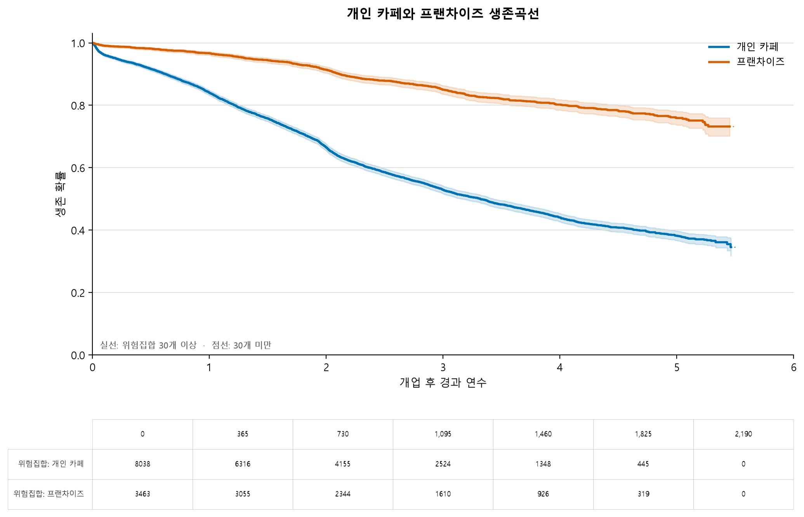

### 연구 질문과 가설

- **경쟁:** 개업 당시 주변(기본 200m)에 카페가 많을수록 폐업 위험이 높다. 경쟁 카페는 개인 카페와 프랜차이즈로 나누어 본다. 프랜차이즈는 분석 대상에서는 빠지지만 경쟁 환경에는 포함된다.
- **수요:** 상권 매출과 유동인구가 높을수록 폐업 위험이 낮다.
- **상쇄:** 수요가 많은 곳에 경쟁도 몰리면 두 효과가 서로를 가릴 수 있다. 두 가지로 검증한다. 가려짐은 수요를 넣기 전후의 경쟁 계수 비교로, 완충은 경쟁×수요 상호작용으로 본다.

### 기존 연구 비교

| 연구 | 대상·자료 | 방법 | 주요 결과 | 이 연구와의 차이 |
|---|---|---|---|---|
| 도시 쇠퇴수준에 따른 커피전문점의 생존율 및 생존요인(도시부동산연구 16(2), 2025) | 2013년 개업 서울 커피전문점 1,745곳, 2019년 말까지 추적, 영업 인허가 자료 | Kaplan–Meier, Cox | 쇠퇴 지역 커피전문점의 생존 기간이 유의하게 짧고 환경 압력에 더 취약 | 행정동 단위 지역 특성(쇠퇴 수준)을 봄. 이 연구는 점포 반경 내 경쟁 수와 거리를 직접 측정하고 개인 카페·프랜차이즈를 나눔 |
| Cho, Kwon, Jeong, Yang(2023), Heliyon | 서울 젠트리피케이션 상권의 외식업 | Cox, 도시 공간 지표 | 경쟁 업종 집적은 폐업 위험을 높이고, 비경쟁 업종 집적과 다양화는 낮춤. 문화시설 접근성은 수요를 늘리지만 경쟁도 심화 | 한 상권 사례를 봄. 이 연구는 서울 전역 카페를 대상으로 하고, 경쟁 효과가 몇 m까지 미치는지와 수요와의 상쇄를 검증 |
| Lee, Lee, Kang, Cheon(2025), PLOS ONE | 서울 상업시설 약 300만 건(2004–2018) | 딥러닝(LSTM) 생존율 예측 | 상권별 생존율 변화를 예측해 8개 유형으로 분류. 도심 업무지구는 감소, 대학가·IT 클러스터는 증가 예측 | 상권 단위 생존율 예측. 이 연구는 개별 점포 단위로 예측하고, 머신러닝을 Cox 결과의 확인 수단으로 씀 |

선행 연구는 경쟁 업종의 집적이 생존에 불리하다는 점(Cho 외, 2023)과 지역 특성이 커피전문점 생존을 가른다는 점(2025년 도시부동산연구)을 보였다. 그러나 경쟁을 상권이나 행정동 단위로 측정해, 점포에서 얼마나 가까운 경쟁이 문제인지는 다루지 않았다. 또 개인 카페와 프랜차이즈를 경쟁자로서 구분한 연구, 수요와 경쟁이 서로를 가리는지 검증한 연구는 찾지 못했다. 머신러닝 연구(Lee 외, 2025)는 상권 단위 예측에 머물렀다.

### 분석의 필요성

이 연구는 세 가지를 더한다. 첫째, 경쟁을 점포 반경 100m·200m·500m로 측정해 경쟁 효과가 미치는 거리를 보인다. 둘째, 경쟁 카페를 개인 카페와 프랜차이즈(저가 커피·대형 커피·음료·디저트)로 나누어 "프랜차이즈 근처를 피해야 하는가"에 답한다. 셋째, 통계 모형과 머신러닝을 함께 써서 입지 정보가 개별 점포의 폐업을 얼마나 설명하는지 한계를 보인다. 결과는 예비 창업자의 입지 판단 기준과 공공 창업 정보 서비스의 개선 방향으로 정리한다.

# 2. 데이터 및 분석 방법

## 2.1 데이터 개요 및 전처리

### 데이터 출처

| 용도 | 데이터 | 기간 | 출처 |
|---|---|---|---|
| 점포별 개업·폐업일, 좌표, 업태, 상호 | 서울시 휴게음식점 인허가 정보 | 전 기간 | 서울 열린데이터광장 |
| 상권 추정 매출, 점포 수 | 서울시 상권분석서비스(추정매출-상권, 점포-상권) | 2021Q1–2025Q4 | 서울 열린데이터광장 |
| 유동인구, 상주인구 | 서울시 상권분석서비스(길단위인구-상권, 상주인구-상권) | 2021Q1–2026Q2 | 서울 열린데이터광장 |
| 상권 경계 | 서울시 상권분석서비스 영역(SHP, 1,650개 상권) | – | 서울 열린데이터광장 |
| 상권 임대료(보조 분석) | 상업용부동산 임대동향 지역별 임대료 | 2021Q1–2026Q3 | 한국부동산원 R-ONE |

### 정의와 전처리

- **카페와 분석 단위:** 인허가 업태구분명이 '커피숍'인 점포를 카페로 본다. 분석 단위는 인허가(운영자)다. 같은 자리에서 주인이 바뀐 양도도 기존 운영자의 폐업으로 본다.
- **개인 카페:** 커피숍 가운데 프랜차이즈를 뺀 점포다. 프랜차이즈는 182개 브랜드의 상호 사전으로 판별했다. 표기 변형(예: 메가MGC커피, 메가엠지씨커피)을 처리했고, '달콤'·'커피나무'처럼 일반 단어인 브랜드는 '○○점' 형태의 지점형 상호만 프랜차이즈로 보았다. 매칭 결과는 표본을 직접 검수했다.
- **표본 제외:** 한시적 인허가(행사·임시 영업), 생존기간 0일 이하, 업태는 커피숍이지만 카페가 아닌 업종(편의점, 만화카페, 보드게임카페, 사주·타로 카페 등)을 분석 대상과 경쟁 점포 수 모두에서 뺐다.
- **개업 기간:** 2021년 2분기–2026년 1분기 개업. 상권 자료가 2021년 1분기부터 있어 개업 직전 분기 값을 붙일 수 있는 범위로 정했다.
- **폐업과 중도절단:** 폐업일이 있으면 폐업으로 본다. 관측 종료일 2026-09-30까지 영업 중이면 중도절단으로 처리한다.
- **공간 결합:** 인허가 좌표(EPSG:5174)와 상권 경계(EPSG:5181)를 같은 좌표계로 맞춘 뒤, 각 카페에서 가장 가까운 상권을 배정했다. 주 분석은 가장 가까운 상권이 200m 안에 있는 카페만 쓴다.
- **경쟁 변수:** 개업일 당시 영업 중이던 카페를 반경 100m·200m·500m 안에서 세었다(개인 카페와 프랜차이즈 따로).
- **수요 변수:** 개업 직전 분기의 상권 총매출, 유동인구, 상주인구. 개업 이후 정보가 들어가지 않게 했다. 점포당 매출은 경쟁 점포 수로 나눈 값이라 수요 지표로 쓰지 않았다.

전처리 후 2021Q2–2026Q1 개업 커피숍은 11,501곳(개인 카페 8,038곳, 프랜차이즈 3,463곳)이었다. 주 분석 표본은 상권이 200m 안에 있고 변수 결측이 없는 개인 카페 7,351곳(폐업 3,411건)이다(그림 2).

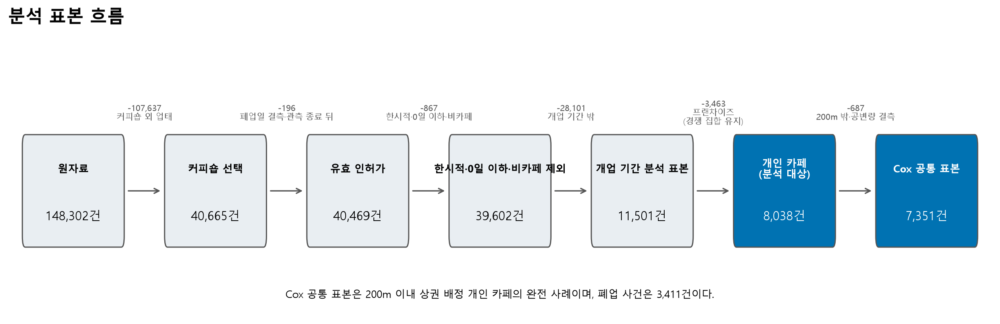

## 2.2 탐색적 데이터 분석(EDA)

### 주요 변수 기술통계

| 변수 | 평균 | 중앙값 | 1사분위 | 3사분위 | 최댓값 |
|---|---|---|---|---|---|
| 100m 안 개인 카페 수 | 2.8 | 2 | 1 | 4 | 25 |
| 200m 안 개인 카페 수 | 7.7 | 6 | 3 | 10 | 46 |
| 200m 안 프랜차이즈 수 | 3.1 | 2 | 0 | 4 | 22 |
| 500m 안 개인 카페 수 | 34.7 | 29 | 17 | 46 | 142 |
| 상권 분기 총매출(억 원) | 547 | 136 | 37 | 494 | 14,496 |
| 상권 분기 유동인구(만 명) | 153 | 112 | 53 | 197 | 882 |
| 상권 상주인구(명) | 3,395 | 2,762 | 1,365 | 4,780 | 21,341 |

경쟁 변수는 좌표가 있는 개인 카페(7,903곳), 상권 변수는 상권이 배정된 전체 커피숍 기준이다. 상권 매출과 유동인구는 한쪽으로 크게 치우쳐 있어 모형에는 자연로그를 취해 표준화한 값을 넣었다.

생존 측면에서 개인 카페의 1·2·3년 생존율은 84.0%, 66.5%, 52.9%였고, 생존기간 중앙값은 1,211일(약 3년 4개월)이었다. 코로나 시기(2021–2022) 개업과 이후(2023년 이후) 개업의 생존곡선은 큰 차이가 없었다(log-rank p=0.96).

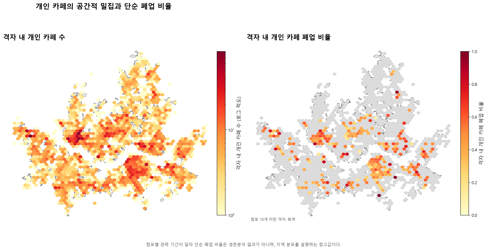

### 경쟁과 생존: 첫 신호

200m 안 개인 카페 수를 사분위로 나누면, 경쟁이 가장 적은 집단의 3년 생존율은 56.4%, 가장 많은 집단은 48.8%였다(순서 추세 검정 p<0.001). 다른 조건을 통제하지 않은 비교지만 경쟁 가설과 같은 방향이다.

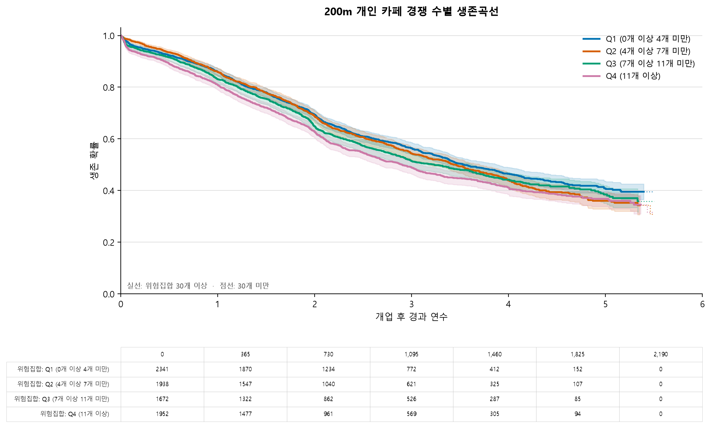

### 상관관계와 다중공선성

경쟁과 수요는 같은 곳에 몰린다. 200m 안 카페 수와 상권 총매출의 순위 상관은 0.53이었다. 손님이 많은 곳에 카페도 많으므로, 수요를 함께 통제하지 않으면 경쟁 효과가 가려지거나 부풀려질 수 있다. 이것이 상쇄 가설을 검증하는 이유다. 공변량 간에는 상권 커피 점포 수와 상권 프랜차이즈 점포 수(0.79), 유동인구와 상주인구(0.67)의 상관이 높았지만, 모형 투입 변수의 분산팽창계수(VIF)는 최대 3.45(로그 총매출)로 다중공선성 문제는 크지 않았다.

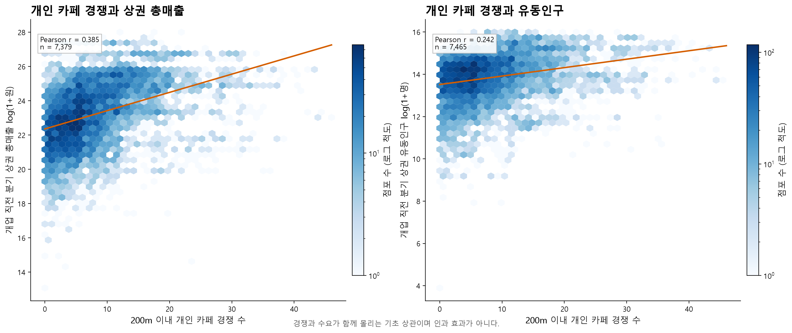

## 2.3 분석 기법 및 모델링

### 통계 모형: Cox 비례위험 모형

Cox 모형은 "어떤 조건의 가게가 같은 시점에 문을 닫을 위험이 몇 배인가"를 추정한다. 결과는 위험비(HR)로 읽는다. 위험비 1.011은 해당 변수가 1 늘 때 폐업 위험이 1.1% 높다는 뜻이고, 1보다 작으면 위험이 낮다는 뜻이다. 아직 영업 중인 가게(중도절단)도 "적어도 지금까지는 살아남았다"는 정보로 함께 쓸 수 있어 생존 자료에 알맞다.

- 개업 연도로 층화해 개업 시점의 경기 차이를 통제했다.
- 같은 상권 점포끼리 비슷할 수 있으므로 상권 단위 군집 강건 표준오차를 썼다.
- 모형을 단계적으로 쌓았다: 상권 모형(상권 구분·수요·상권 커피 점포 수) → 점포 단위 경쟁 추가 → 경쟁만 → 경쟁+수요 → 경쟁×수요 상호작용.

### 강건성 검증

- 반경 100m·500m, 거리 구간(0–100m, 100–200m) 분해
- 표본 변경: 상권이 200m 밖인 카페 포함, 프랜차이즈 포함 전체 커피숍, 같은 자리·같은 상호로 하루 안에 다시 인허가받은 경우를 하나로 합친 표본
- 분기별 시변 Cox: 개업 후 주변 경쟁·수요가 분기마다 바뀌는 것을 반영, R-ONE 상권 임대료 보조 분석
- 기간 확장: 2015년 이후 개업 19,276곳(상권 매출 자료가 없어 경쟁과 상권 구분만 투입)
- 프랜차이즈 유형(저가 커피·대형 커피·음료·디저트·기타)과 거리로 분해

### 머신러닝

| 목적 | 모형 | 평가 지표 |
|---|---|---|
| 생존 예측(중도절단 반영) | 랜덤 생존 숲, XGBoost 생존 모형, 비교용 Cox | Harrell's C, Uno's C, 1·2·3년 시간 의존 AUC, 통합 Brier 점수 |
| 개업 2년 안 폐업 여부 분류 | 로지스틱 회귀, 의사결정나무, 랜덤 포레스트, XGBoost, 기준선(다수 클래스, 개업 연도만) | 정확도, 정밀도, 재현율, F1, ROC-AUC, PR-AUC |
| 변수 중요도·관계 모양 | 순열 중요도, SHAP | 평가 데이터에서 변수를 섞었을 때 성능 감소량, 평균 절대 SHAP 값 |

- **교차검증:** 같은 상권의 점포가 학습과 평가에 나뉘어 들어가면 성능이 부풀려진다. 그래서 상권 단위로 묶은 5겹 교차검증(GroupKFold)을 썼다.
- **분류 문제 설정:** 생존 자료는 아직 영업 중인 가게가 섞여 있어 정확도를 바로 계산할 수 없다. 그래서 2년을 끝까지 지켜볼 수 있는 가게(2024-09-30 이전 개업 5,737곳)만으로 "2년 안에 폐업했는가"를 맞히는 분류 문제를 따로 만들었다. 폐업이 33.4%로 소수이므로, 모든 모형이 학습 데이터의 폐업 비율만큼 위험 상위 가게를 '폐업'으로 예측하도록 기준값을 맞춰 공정하게 비교했다.
- **입력 변수:** Cox 공변량 전부, 개업 연도, 프랜차이즈 유형별 수, 거리 구간별 개인 카페 수.

# 3. 분석 결과

## 3.1 모델링 및 세부 분석 결과

### 경쟁: 주변 개인 카페가 많을수록 위험

점포 단위 경쟁을 넣은 모형에서 200m 안 개인 카페 1곳당 위험비는 1.011(1.003–1.019, p=0.008)이었다. 사분위 범위(3곳→10곳)만큼 늘면 위험이 약 8% 높아지는 크기다. 프랜차이즈 1곳당은 1.006(0.988–1.024, p=0.53)으로 뚜렷한 연관이 없었다. 상권 모형에 점포 단위 경쟁을 더하면 모형 적합이 유의하게 좋아졌다(우도비 검정 p<0.001). 상권 단위 지표만으로는 놓치는 정보가 점포 주변 경쟁에 있다는 뜻이다.

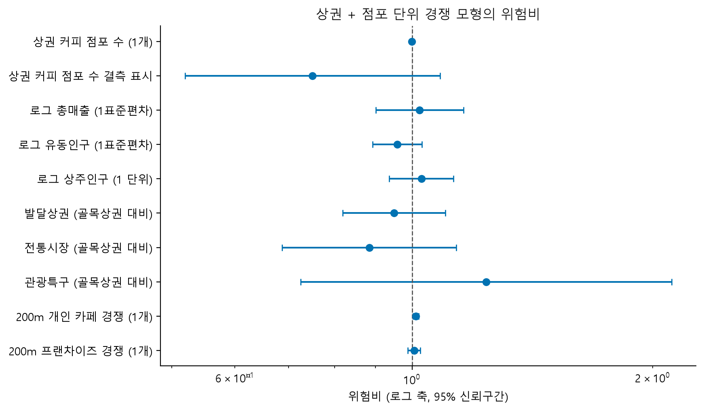

이 결과는 모든 강건성 검증에서 유지됐다(그림 7). 상권이 먼 카페를 넣어도, 프랜차이즈를 포함해도, 재인허가를 합쳐도, 개업 후 경쟁 변화를 반영한 시변 모형(1.011, 1.001–1.021)에서도, 2015년 개업까지 넓힌 표본(1.020, 1.000–1.040)에서도 같았다. 확장 표본에서 코로나 이전 개업(1.030)과 코로나 이후 개업(1.014)에서도 연관이 보였다.

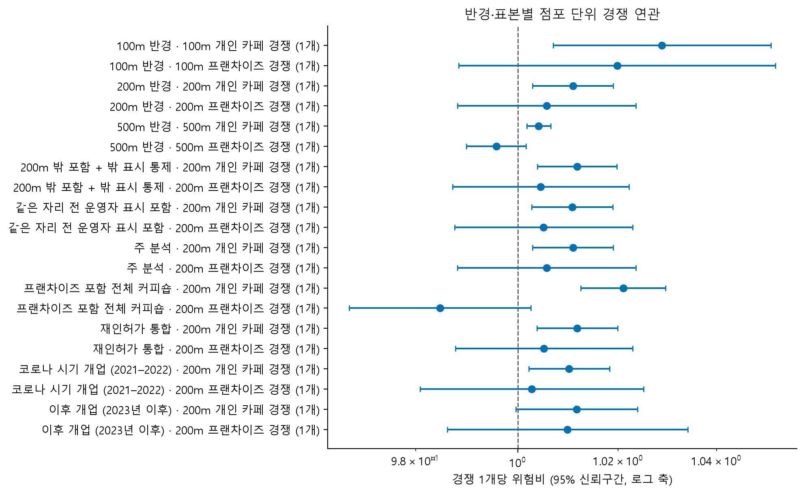

### 거리: 문제는 바로 옆 100m

경쟁을 거리 구간으로 나누면 연관은 100m 안에 몰려 있었다. 0–100m 개인 카페 1곳당 위험이 약 2.8% 높았고, 100–200m 카페는 0에 가까웠다. 반경을 바꾼 모형에서도 1곳당 효과는 100m 2.9%, 200m 1.1%, 500m 0.4%로 반경이 넓을수록 작아졌다. 멀리 있는 카페가 섞일수록 효과가 희석된다는 것으로, 같은 이야기다.

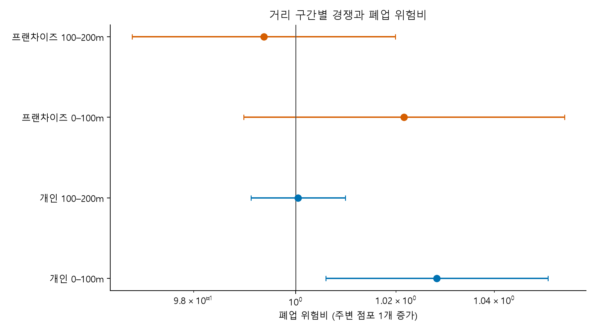

### 프랜차이즈: 피해야 한다는 근거는 없다

프랜차이즈를 저가 커피(메가MGC커피·컴포즈커피 등), 대형 커피(스타벅스·투썸플레이스 등), 음료·디저트로 나누어도 어느 유형도 뚜렷한 연관이 없었다. 저가 커피와 대형 커피의 차이도 없었다(p=0.78). 표본이 큰 확장 분석에서 프랜차이즈 1곳당 위험비는 0.998(0.986–1.011)로, 신뢰구간 상한으로 보아도 개인 카페 1곳의 영향보다 작다. 다만 프랜차이즈와 10m 안(사실상 같은 건물·단지 상가)에 개업한 경우 위험비 1.26(p=0.042)으로 높았는데, 해당 사례가 적고 다중 비교를 고려하면 주의 신호로만 본다.

### 수요와 상쇄

상권 총매출(1표준편차당 1.019, 0.918–1.130)과 유동인구(0.951, 0.876–1.031)는 폐업 위험과 뚜렷한 연관이 없었다.

- **가려짐:** 수요를 넣기 전후 개인 카페 경쟁 계수의 변화는 +0.1%에 그쳤다. 경쟁과 수요가 같은 곳에 몰리기는 하지만, 수요가 경쟁 효과를 가린다는 근거는 없었다.
- **완충:** 경쟁×유동인구 상호작용은 0.990(p=0.024)으로, 유동인구가 많은 곳에서 경쟁 연관이 약해지는 방향이었다. 그러나 시변 모형에서는 p=0.094로 약해졌고, 경쟁×총매출 상호작용은 없었다(p=0.23). 완충은 가능성 정도로만 해석한다.

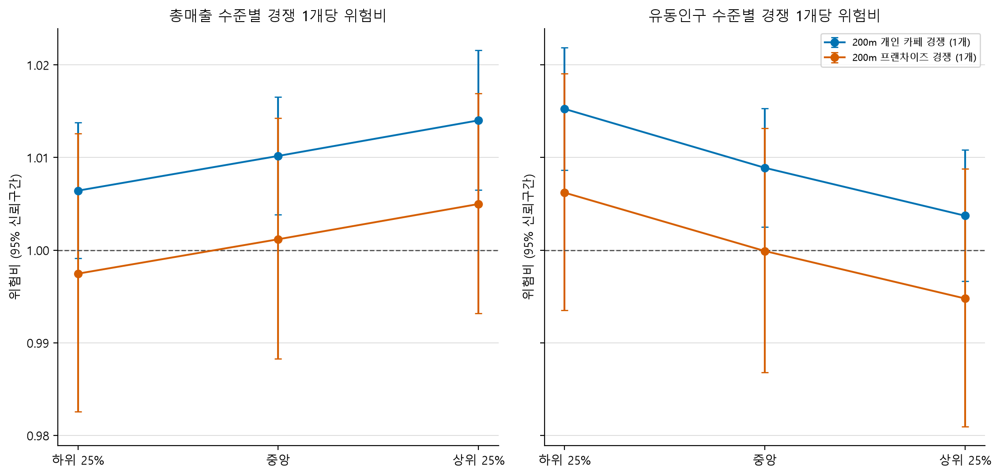

### 모델 성능 비교

**생존 예측.** 상권 단위 5겹 교차검증에서 모든 모형의 C-index가 0.50–0.51이었다. C-index 0.5는 동전 던지기 수준이다. 비선형 관계와 변수 간 상호작용을 스스로 찾는 랜덤 생존 숲과 XGBoost도 Cox보다 낫지 않았다. Cox의 예측력이 낮은 것이 모형 형태 때문이 아니라 입지 정보 자체의 한계임을 뜻한다.

| 모형 | Harrell's C | Uno's C | 2년 시간 의존 AUC | 통합 Brier 점수 |
|---|---|---|---|---|
| 기준선(개업 연도만) | 0.500 | 0.497 | 0.533 | 0.206 |
| Cox(전체 변수) | 0.514 | 0.512 | 0.515 | 0.208 |
| 랜덤 생존 숲 | 0.503 | 0.501 | 0.485 | 0.210 |
| XGBoost 생존 모형 | 0.504 | 0.503 | 0.499 | 0.209 |

**2년 안 폐업 분류.** 2년을 지켜볼 수 있는 5,737곳 중 1,915곳(33.4%)이 2년 안에 폐업했다.

| 모형 | 정확도 | 정밀도 | 재현율 | F1 | ROC-AUC |
|---|---|---|---|---|---|
| 기준선: 모두 생존으로 예측 | 0.666 | 0.000 | 0.000 | 0.000 | 0.500 |
| 기준선: 개업 연도만 | 0.560 | 0.311 | 0.270 | 0.274 | 0.491 |
| 로지스틱 회귀 | 0.573 | 0.342 | 0.300 | 0.318 | 0.509 |
| 의사결정나무 | 0.599 | 0.362 | 0.235 | 0.256 | 0.510 |
| 랜덤 포레스트 | 0.570 | 0.349 | 0.333 | 0.340 | 0.517 |
| XGBoost | 0.570 | 0.342 | 0.314 | 0.326 | 0.519 |

정확도만 보면 "모두 생존"이라고 찍는 기준선(0.666)이 가장 높다. 폐업이 소수여서 생기는 착시다. 모형이 '폐업'이라고 찍은 가게 중 실제 폐업 비율(정밀도)은 0.34–0.36으로, 아무 가게나 찍었을 때 맞는 비율(0.334)과 거의 같다. ROC-AUC도 0.51–0.52로 무작위 수준이다. 1년·3년 기준으로 바꾸어도 같았다.

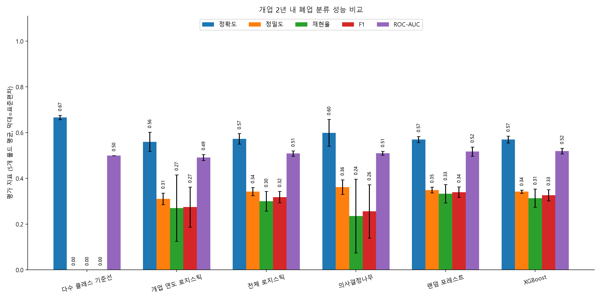

### 주요 영향 요인(변수 중요도)

- **1순위: 주변 개인 카페 수.** Cox에서 신뢰구간이 1을 벗어난 유일한 변수다(200m 1곳당 위험비 1.011, 0–100m 1곳당 1.028). 랜덤 생존 숲의 순열 중요도에서도 0–100m 개인 카페 수가 1위였고, 2년 폐업 분류의 XGBoost 순열 중요도에서도 200m 개인 카페 수가 1위였다(ROC-AUC 감소 0.009).
- **2순위: 뚜렷한 2순위는 없다.** 분류 모형에서 100–200m 프랜차이즈 수(0.005)와 200m 저가 커피 체인 수(0.005)가 뒤를 이었지만, Cox에서는 연관이 없었고 교차검증 회차마다 순위가 바뀌었다.

모형의 구분력 자체가 낮아 머신러닝 변수 순위는 불안정하다(교차검증 회차 간 표준편차가 평균보다 큰 변수가 대부분). 따라서 중요도는 Cox 결과와 일치하는 부분, 즉 "주변 개인 카페 수가 가장 일관된 변수"라는 점만 결론에 쓴다.

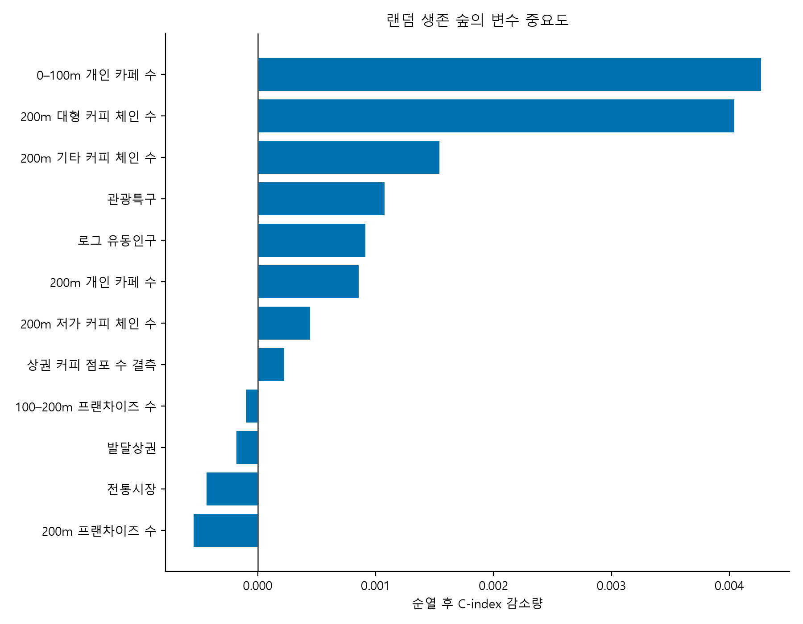

### 시각화: 경쟁에 따른 위험의 모양

머신러닝으로 경쟁 수에 따른 위험 변화의 모양을 보았다. 0–100m 개인 카페 수가 늘수록 위험이 완만하게 오르는 모양이었고, 특정 수에서 급격히 꺾이는 임계값은 보이지 않았다.

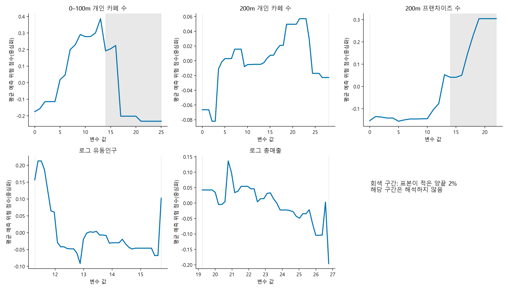

# 4. 결론

## 4.1 결과 해석 및 의미

### 핵심 결론

1. **바로 옆의 개인 카페가 폐업 위험과 가장 일관되게 연관된다.** 개업 당시 100m 안 개인 카페 1곳당 위험이 약 3% 높았다. 이 연관은 반경·표본·기간·모형을 바꾸어도 유지됐다.
2. **프랜차이즈는 개인 카페의 폐업 위험과 뚜렷한 연관이 없다.** 저가 커피든 대형 커피든 마찬가지였다.
3. **상권의 매출·유동인구는 폐업 위험을 설명하지 못했고, 경쟁 효과를 가리지도 않았다.**
4. **입지 정보만으로는 개별 카페의 폐업을 맞힐 수 없다.** 복잡한 머신러닝 모형도 무작위 예측과 비슷했다.

### 원인과 배경 해석

- **왜 개인 카페끼리인가.** 개인 카페는 메뉴·가격대·분위기가 서로 비슷해 같은 손님을 두고 직접 경쟁하기 쉽다. 프랜차이즈는 브랜드 충성 고객, 가격대(저가 커피) 또는 공간(대형 매장) 면에서 개인 카페와 손님층이 다를 수 있다. 또 프랜차이즈가 입점한 곳은 본사가 상권을 분석해 고른 자리라, 프랜차이즈가 끌어오는 유동 손님이 경쟁 피해를 일부 상쇄할 수도 있다. 이 자료로는 두 설명을 가를 수 없다.
- **왜 100m인가.** 카페는 걸어서 들르는 업종이다. 손님이 비교하는 범위가 한 블록 정도라면 경쟁도 그 안에서 일어난다.
- **왜 수요가 안 보이는가.** 손님이 많은 상권은 임대료도 높고 경쟁도 많다. 상권 평균 매출은 그 상권의 모든 업종 매출이라 개별 카페가 가져가는 몫을 보여 주지 못한다. 상권 단위 수요 지표가 개별 점포의 생존과 잘 이어지지 않는 이유로 보인다.
- **왜 예측이 안 되는가.** 카페의 생존은 입지보다 운영(메뉴, 가격, 서비스), 자금 여력, 창업자의 경험처럼 이 자료에 없는 요인이 크게 좌우한다고 해석된다. 입지는 위험을 조금 올리거나 내리는 요인일 뿐 결과를 정하지 않는다.

선행 연구와 비교하면, 경쟁 업종 집적이 위험을 높인다는 Cho 외(2023)의 결과와 같은 방향이다. 이 연구는 그 경쟁이 100m 안의 같은 업태 개인 점포에서 나온다는 점을 더했다.

## 4.2 실행 제언

### 예비 창업자

1. **상권 평균 대신 내 자리 100m 안의 개인 카페 수를 직접 세어 본다.** 상권 매출이 높다는 것만으로 안전하지 않다. 100m 안 개인 카페가 3곳 많으면 폐업 위험은 약 9% 높다.
2. **프랜차이즈 매장 근처를 무조건 피할 필요는 없다.** 다만 같은 건물에 들어가는 경우는 신중히 본다.
3. **입지는 출발점일 뿐이다.** 입지만으로 생존을 장담할 수 없으므로 메뉴 차별화, 고정비 관리, 운영 자금 확보를 함께 준비한다.

### 공공 창업 정보 서비스(서울시 상권분석서비스 등)

1. **점포 반경 근접 경쟁 지표를 제공한다.** 지도에서 자리를 찍으면 반경 100m 안 같은 업종의 개인 점포·프랜차이즈 수와 최근 개·폐업 현황을 보여 준다. 인허가 좌표로 바로 계산할 수 있다.
2. **상권 매출 지표의 한계를 안내한다.** 상권 총매출은 개별 점포의 생존 가능성을 보여 주지 못한다는 점을 함께 알린다.
3. **폐업 예측 점수 같은 기능은 신중해야 한다.** 이 연구에서 입지 정보로 만든 예측은 무작위 수준이었다. 근거 없는 점수는 창업자에게 잘못된 확신을 줄 수 있다.

## 4.3 연구의 한계점

- **임대료:** 점포별 실제 임대료 자료가 없다. 인허가 자료의 월세액은 모두 0이었고, R-ONE 상권 임대료는 큰 상권 약 70곳의 평균이라 개인 카페 절반에만 붙일 수 있었다. 임대료를 넣어도 경쟁 결과는 같았지만, 개별공시지가 같은 점포 단위 대체 지표는 다루지 못했다.
- **점포 내부 요인:** 메뉴, 가격, 좌석 수, 자본금, 창업자 경험 등 운영 요인은 자료가 없다. 예측력이 낮은 주된 이유로 보인다.
- **폐업의 의미:** 인허가 폐업일 기준이라 양도(주인 변경)나 다른 자리로의 이전도 폐업으로 잡힌다. 재인허가를 합친 강건성 표본에서도 결과는 같았다.
- **수요 자료의 기간:** 상권 매출이 2021년부터 있어 코로나 이전 개업에는 수요 변수를 넣을 수 없었다.
- **비례위험 가정:** 상권 매출은 개업 초기와 이후에 효과가 다를 수 있다는 기미가 있었다(잔차 진단 p=0.006). 다만 구간을 나눈 모형의 차이 검정은 유의하지 않았고(p=0.28), 경쟁 변수에서는 위반이 없었다.
- **인과 해석:** 관찰 자료이므로 결과는 연관이다. 예컨대 경쟁이 많은 곳의 다른 특성(임대료 등)이 함께 작용했을 수 있다.
- **프랜차이즈 판별:** 상호 사전 방식이라 소규모 체인 일부가 개인 카페로 분류됐을 수 있다. 소규모 체인을 개인 카페로 바꾸어 분류해도 결론은 같았다.

**차후 개선:** 개별공시지가로 점포 단위 임대료 대리 지표를 넣고, 카드 매출 등 점포 단위 실적 자료나 공정거래위원회 가맹정보를 결합하면 예측력과 프랜차이즈 판별을 개선할 수 있다.

# 5. 참고문헌 및 데이터 출처

### 데이터

- 서울특별시. 서울시 휴게음식점 인허가 정보. 서울 열린데이터광장. https://data.seoul.go.kr
- 서울특별시. 서울시 상권분석서비스(추정매출-상권, 점포-상권, 길단위인구-상권, 상주인구-상권, 영역-상권). 서울 열린데이터광장. https://data.seoul.go.kr
- 한국부동산원. 상업용부동산 임대동향 지역별 임대료. 부동산통계정보시스템 R-ONE. https://www.reb.or.kr/r-one

### 참고 문헌

- 도시 쇠퇴수준에 따른 커피전문점의 생존율 및 생존요인에 관한 연구: 서울시 행정동을 중심으로. 도시부동산연구, 16(2), 59–77, 2025. https://doi.org/10.21447/jusre.2025.16.2.3
- Cho, W., Kwon, Y., Jeong, K. S., & Yang, J. (2023). Survival characteristics of food and beverage businesses in a gentrified commercial area: A case study in Seoul, Korea. Heliyon, 9(11), e21514. https://doi.org/10.1016/j.heliyon.2023.e21514
- Lee, D., Lee, J., Kang, M., & Cheon, S. (2025). Classification of commercial districts based on predicting the survival rate of food service market in Seoul. PLOS ONE, 20(7), e0326307. https://doi.org/10.1371/journal.pone.0326307
- Cox, D. R. (1972). Regression models and life-tables. Journal of the Royal Statistical Society: Series B, 34(2), 187–220.
- Ishwaran, H., Kogalur, U. B., Blackstone, E. H., & Lauer, M. S. (2008). Random survival forests. The Annals of Applied Statistics, 2(3), 841–860.
- Chen, T., & Guestrin, C. (2016). XGBoost: A scalable tree boosting system. Proceedings of the 22nd ACM SIGKDD, 785–794.
- Lundberg, S. M., & Lee, S.-I. (2017). A unified approach to interpreting model predictions. Advances in Neural Information Processing Systems 30.

### 분석 도구

Python 3.13 — pandas, geopandas, lifelines(Cox·Kaplan–Meier), scikit-learn, scikit-survival(랜덤 생존 숲), xgboost, shap, matplotlib. 분석 코드: https://github.com/ksh4043/Cafe-Survival-Analytics

### 사용한 생성형 AI

- **Claude (Anthropic):** 분석 설계 논의(가설 구체화, 표본 정의, 모형 설계), 단계별 분석 작업 지시문 작성, 분석 결과 검토와 오류 수정 지시, 일부 분석 코드 작성, 보고서 초안 작성.
- **Codex (OpenAI):** 작업 지시문에 따른 데이터 전처리·공간 결합·생존분석·머신러닝·시각화 코드 작성과 실행.
- 연구 질문, 카페·폐업 정의, 표본 제외 기준, 가설 같은 결과가 달라지는 결정은 연구자가 직접 내렸고, AI가 만든 결과는 연구자가 검토했다.

# 부록

## 부록 A. 생존곡선 추가

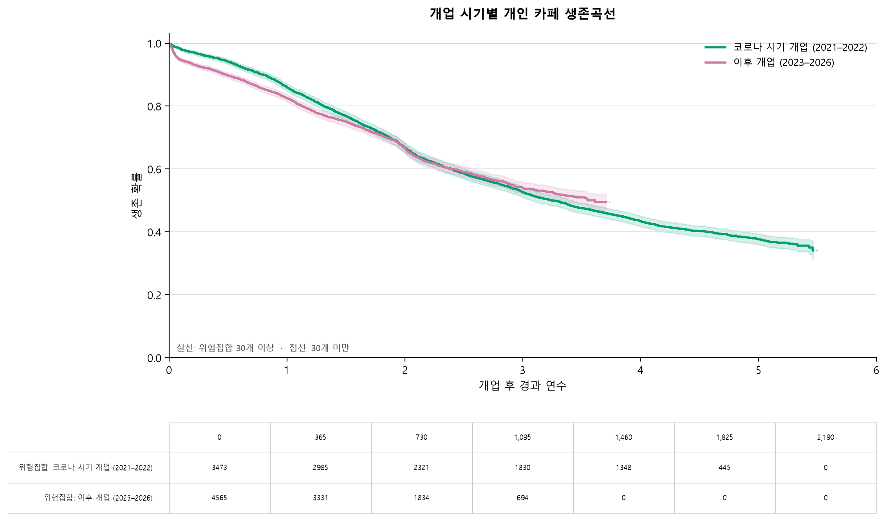

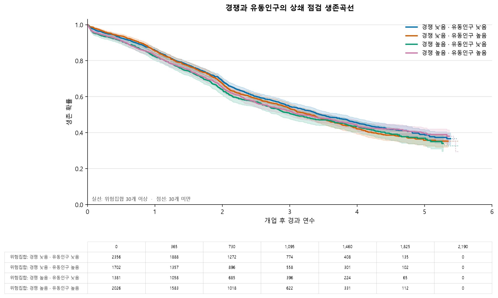

## 부록 B. 강건성 검증

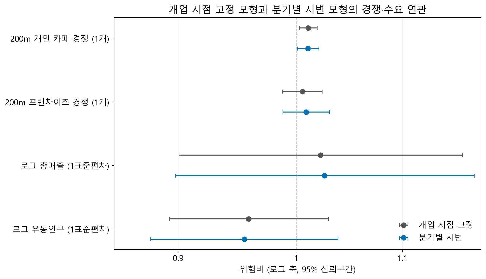

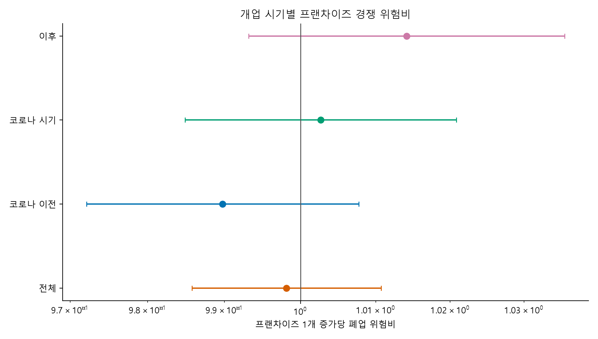

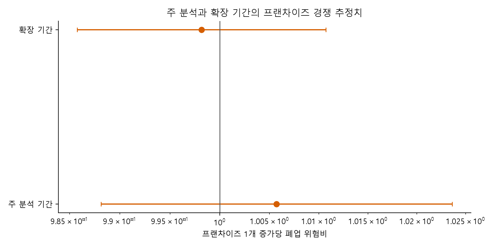

| 검증 | 표본 수 | 개인 카페 경쟁 위험비(95% CI) |
|---|---|---|
| 주 분석(200m) | 7,351 | 1.011 (1.003–1.019) |
| 반경 100m | 7,351 | 1.029 (1.007–1.051) |
| 분기별 시변 Cox | 7,351 | 1.011 (1.001–1.021) |
| 2015년 이후 개업 확장 | 19,276 | 1.020 (1.000–1.040) |
| 확장 표본, 소규모 체인을 개인 카페로 재분류 | 20,302 | 1.017 (1.000–1.034) |

## 부록 C. 머신러닝 추가 결과

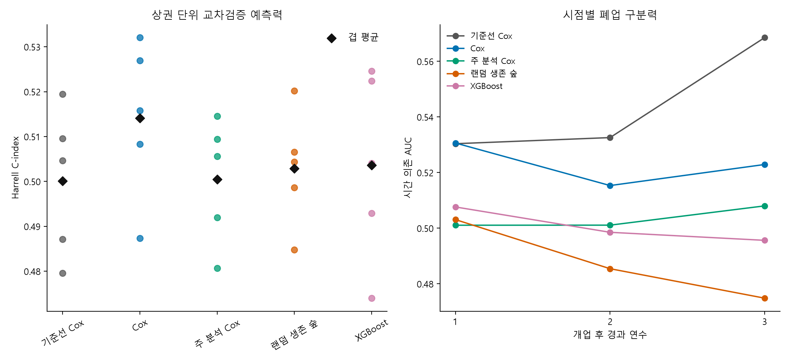

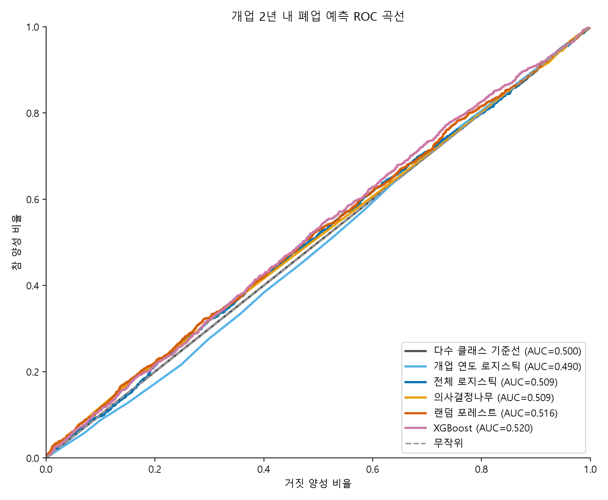

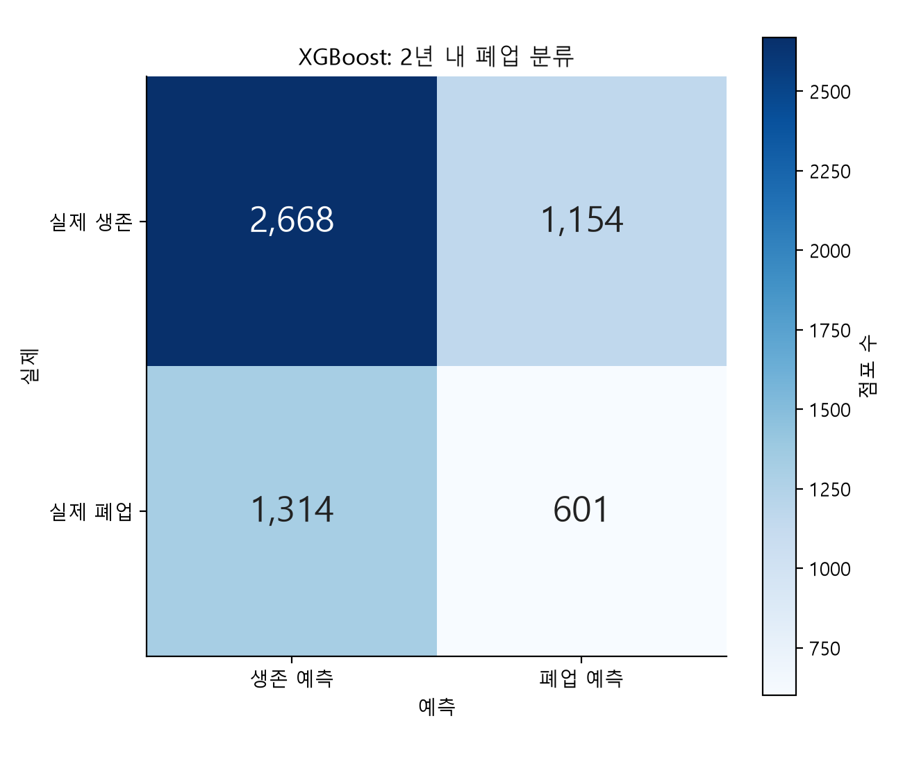

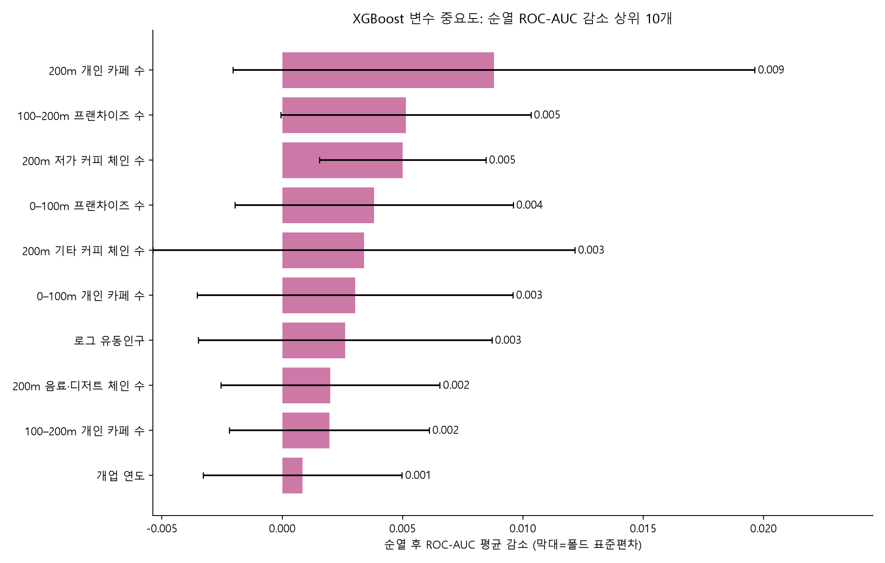

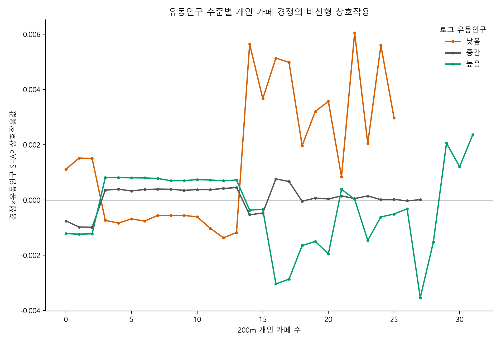
