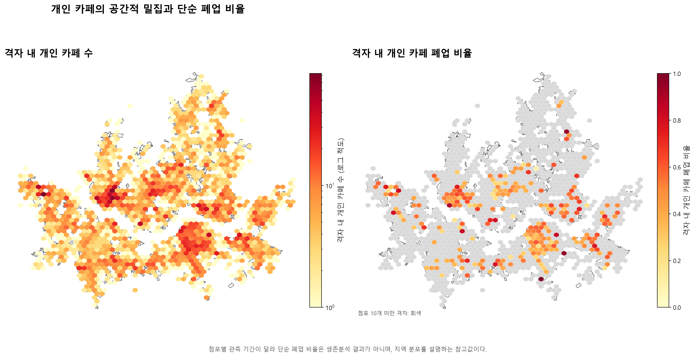

# 공간 결합과 반경 경쟁 변수 보고서

## 주요 결과

개업 당시 200m 안의 활동 카페 수는 좌표 보유 분석 표본에서 평균 10.9개, 중앙값 9개였다. 개인 카페 경쟁은 평균 7.4개, 프랜차이즈 경쟁은 평균 3.4개로, 전자는 전체 200m 경쟁의 68.3%를 차지한다. 반경을 100m·200m·500m로 넓히면 전형적(중앙값) 경쟁 수는 각각 3개·9개·40개다. 상위 점포는 이화여대길·명동·마곡 등 상업 밀집 지역에 분포한다.

| 표본 | 경쟁 구분 | 유효 표본 수 | 평균 | 중앙값 | 1사분위 | 3사분위 | 최댓값 | 0 비율(%) |
| --- | --- | --- | --- | --- | --- | --- | --- | --- |
| 전체 분석 표본 | 개인 카페 | 11294 | 7.446 | 6.0 | 3.0 | 10.0 | 46 | 4.59 |
| 전체 분석 표본 | 프랜차이즈 | 11294 | 3.45 | 2.0 | 1.0 | 5.0 | 24 | 21.38 |
| 전체 분석 표본 | 합계 | 11294 | 10.896 | 9.0 | 5.0 | 15.0 | 61 | 2.77 |

200m 경쟁의 연도별 평균은 2021년 10.373개에서 2024년 11.474개로 높아졌다가 2025년 11.139개, 2026년 10.553개였다. 이는 개업 시점별 시장 환경 차이가 있음을 뜻하며, 후속 생존모형에서는 개업 시기 통제가 필요할 수 있다.

| 개업_연도 | 200m 평균 경쟁 카페 수 |
| --- | --- |
| 2021 | 10.373 |
| 2022 | 10.835 |
| 2023 | 10.84 |
| 2024 | 11.474 |
| 2025 | 11.139 |
| 2026 | 10.553 |

좌표 보유 점포 11,294개 중 폴리곤 내부는 8,439개(74.7%)이고 밖은 2,855개(25.3%)다. 폴리곤 밖 점포는 상권으로 지정되지 않은 주거지에 주로 있을 수 있다는 해석이 가능하지만, 이 SHP는 상권 경계이지 토지이용도 자료가 아니므로 주거지라고 단정할 수 없다. 주소 자치구 분포 상위는 다음과 같아 폴리곤 밖 사례가 특정 한 구에만 모이지는 않는다.

| 주소 자치구 | 폴리곤 밖 점포 수 |
| --- | --- |
| 강서구 | 296 |
| 송파구 | 192 |
| 노원구 | 176 |
| 강남구 | 169 |
| 강동구 | 157 |

같은 좌표에서 개업일 또는 직전일에 폐업한 전 운영 인허가가 있는 점포는 884개(7.7%)다. `has_predecessor_same_site` 표지는 보존했으며, 이번 단계에서는 표본 제외나 모형 활용 여부를 정하지 않았다.

### 자치구 불일치의 처리

주소 자치구와 **점포가 실제로 포함된** 상권 폴리곤 속성 자치구를 비교할 수 있었던 8,439개 중 214개(2.5%)가 불일치했다. 일치는 8,225개(97.5%)다. 불일치 조합 상위는 다음과 같다.

| 주소 자치구 | 폴리곤 속성 자치구 | 점포 수 |
| --- | --- | --- |
| 강남구 | 서초구 | 73 |
| 서초구 | 강남구 | 38 |
| 마포구 | 서대문구 | 19 |
| 강서구 | 양천구 | 10 |
| 관악구 | 동작구 | 10 |
| 서초구 | 동작구 | 9 |
| 관악구 | 금천구 | 6 |
| 양천구 | 강서구 | 6 |
| 서대문구 | 종로구 | 6 |
| 동작구 | 서초구 | 5 |

하나은행 본점·그랑서울·명동 매장 등 표본 점검에서는 변환 좌표가 실제 위치 수십 m 안에 맞았고, 강남역처럼 구 경계에 걸친 상권의 폴리곤 속성 자치구와 주소 자치구가 다를 수 있음을 확인했다. 다만 현재 입력에는 **자치구 행정경계 도형이 없고**, 상권 SHP의 각 폴리곤에는 자치구 속성이 하나만 있으므로 216개 모두에 대해 ‘점포-구 경계 거리’나 ‘하나의 상권이 두 구에 걸침’을 수치로 검증할 수는 없다. 상권 변수는 자치구가 아니라 점포가 포함된/최근접한 상권 폴리곤을 기준으로 하므로 배정을 바꾸지 않는다. 후속 모형에서 자치구 통제가 필요하면 폴리곤 속성이 아니라 **주소 자치구**를 사용한다. 정확한 경계거리 검증은 기준일이 명시된 공식 자치구 경계 자료를 추가한 뒤 수행해야 한다.

같은 육각 격자에서 개인 카페 수와 단순 폐업 비율의 지역 분포를 비교한다.

## 방법과 검증

상권 SHP의 원 좌표계 EPSG:5181을 거리 계산 공통 좌표계로 사용했고, 인허가 좌표는 선언된 EPSG:5174에서 변환했다. 상권 폴리곤이 하나 이상 겹친 366개 점포(최대 2개)는 상권 코드가 작은 값을 재현 가능하게 선택했다. 이는 중복 행 방지를 위한 기술 규칙이다.

폴리곤 밖 점포의 최근접 상권 거리는 중앙값 81.7m이며, 50m·100m·200m·500m 안인 비율은 각각 36.6%·56.1%·76.6%·94.2%다. 폴리곤 밖 점포도 버리지 않고 최근접 상권 코드·거리를 보존했으며, 후속 상권 변수 결합에서는 이 거리를 표본 구분 표지로 쓴다.

경쟁 집합은 기간 밖 점포와 프랜차이즈를 포함한 전체 카페다. 대상 점포의 개업일보다 먼저 개업하고 그날 아직 폐업하지 않은 카페만 기본 경쟁 수에 포함했으며, 같은 날 개업은 별도 변수로 셌다. 따라서 개업 뒤 정보는 사용하지 않았다. 좌표가 없어 경쟁 변수가 결측인 표본은 207개다.

시드 20261120로 무작위 점포 5개를 뽑아 200m 전수 거리 계산과 비교했고 모두 일치했다.

| 분석 행 | 개업일 | brute_force_개인 | 산출_개인 | brute_force_프랜차이즈 | 산출_프랜차이즈 | 일치 |
| --- | --- | --- | --- | --- | --- | --- |
| 1713 | 2022-03-10 | 6 | 6 | 4 | 4 | True |
| 4737 | 2021-04-20 | 2 | 2 | 0 | 0 | True |
| 5285 | 2025-06-19 | 5 | 5 | 6 | 6 | True |
| 8405 | 2024-10-14 | 4 | 4 | 0 | 0 | True |
| 8508 | 2022-10-24 | 7 | 7 | 9 | 9 | True |

재실행은 같은 입력에서 같은 파케이 결과를 내야 한다. 원자료를 수정하지 않고 `.tmp/`를 `TEMP`/`TMP`로 지정해 실행하며, 결과 해시는 별도 검증 명령으로 확인했다.

## 산출물

- `data/processed/cafes_spatial.parquet`: 11,501개 분석 점포의 공간·경쟁 변수
- `docs/tables/03_competition_summary.csv`: 반경·표본·경쟁 구분별 분포
- `docs/review/03_district_mismatch.csv`: 주소-폴리곤 자치구 불일치 표본
- `docs/review/03_outside_polygon.csv`: 상권 폴리곤 밖 점포 표본

| 상호 | 도로명 주소 | 지번 주소 | 자치구 | 200m 경쟁 수 | 같은 도로명 주소 인허가 수 |
| --- | --- | --- | --- | --- | --- |
| 소호 커피 & 베이커리 | 서울특별시 중구 남대문로 84, 9층 (남대문로2가) | 서울특별시 중구 남대문로2가 9-1  | 중구 | 61 | 1 |
| 볼비(bowl-b) | 서울특별시 서대문구 이화여대7길 15, 1층 (대현동) | 서울특별시 서대문구 대현동 56-86  | 서대문구 | 60 | 1 |
| 커피빈 하나은행본관로비점 | 서울특별시 중구 을지로 35 (주)하나은행 본점 1층 (을지로1가) | 서울특별시 중구 을지로1가 101-1 (주)하나은행 본점  | 중구 | 59 | 1 |
| 피커 PICKER | 서울특별시 강서구 마곡동로3길 26, 랑데르2 1층 112호 (마곡동) | 서울특별시 강서구 마곡동 774-5 랑데르2 112호 | 강서구 | 58 | 1 |
| 드로윙 커피하우스 | 서울특별시 서대문구 이화여대길 37, 1층 (대현동) | 서울특별시 서대문구 대현동 56-76  | 서대문구 | 57 | 2 |
| 메가엠지씨커피 명동입구점 2호 | 서울특별시 중구 남대문로 74, 2,3,4층 (남대문로2가) | 서울특별시 중구 남대문로2가 14-6  | 중구 | 57 | 1 |
| 커피도가 헤리티지 | 서울특별시 서대문구 이화여대5길 9, 102호 (대현동, 파크제이드 이화) | 서울특별시 서대문구 대현동 56-28 파크제이드 이화 102호 | 서대문구 | 57 | 1 |
| 베르데비앙(VERDEBIAN) | 서울특별시 강서구 공항대로 194, 문영 퀸즈파크12차 1층 112호 (마곡동) | 서울특별시 강서구 마곡동 799-3 문영 퀸즈파크12차  | 강서구 | 56 | 1 |
| 리앤커피(LIAN Coffee) | 서울특별시 중구 명동길 7, 1,2층 (명동1가) | 서울특별시 중구 명동1가 76-3  | 중구 | 55 | 1 |
| 카페아이엠티 종로그랑서울점 | 서울특별시 종로구 종로 33, 그랑서울 103호, 104호 (청진동) | 서울특별시 종로구 청진동 70 그랑서울 103호, 104호  | 종로구 | 54 | 1 |
