# Kaplan–Meier 생존곡선 보고서

## 주요 결과

이 분석은 인허가 단위의 카페 점포 생존을 단변량으로 비교한 탐색 결과다. 주 분석 대상인 개인 카페는 8,038개이며, 관측 종료일은 2026-09-30이다. 아래의 p값은 차이의 크기를 대신하지 않으므로, 각 비교에서 생존확률의 방향과 간격을 먼저 확인해야 한다. 다른 입지·수요·개업 시기는 통제하지 않았으며, Cox 단계에서 함께 확인할 사항이다.

개인 카페 전체 곡선은 `04_km_overall.png`에 제시했다. 표본별 점포 수, 사건 수, 중앙 생존기간과 신뢰구간, 1·2·3년 생존확률은 `docs/tables/04_km_summary.csv`에 모두 수록했다. 중앙 생존기간의 신뢰구간이 `—`인 경우에는 해당 신뢰구간 곡선이 50%에 이르지 않아 추정되지 않은 것이다.

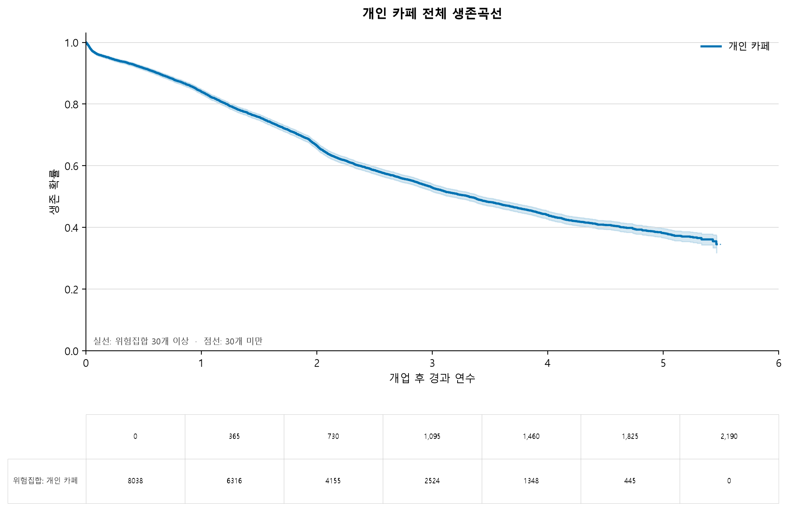

개인 카페 전체의 Kaplan–Meier 생존곡선을 보여 준다.
개업 시기 비교에서는 코로나 시기 개업 (2021–2022) 3,473개(사건 2,108건, 1년 생존 85.9%, 3년 생존 52.7%); 이후 개업 (2023–2026) 4,565개(사건 1,618건, 1년 생존 82.5%, 3년 생존 54.0%) (전체 log-rank p=0.959)였다. 이후 개업 집단은 1년 생존확률이 더 낮지만(82.5% 대 85.9%), 3년은 54.0% 대 52.7%로 역전되어 곡선이 교차한다. 2023년 이후 개업 점포는 관측 가능한 기간이 짧으므로, 이 두 집단은 **두 집단 모두가 관측된 공통 기간**까지만 비교해야 하며 3년 차이는 불안정할 수 있다.

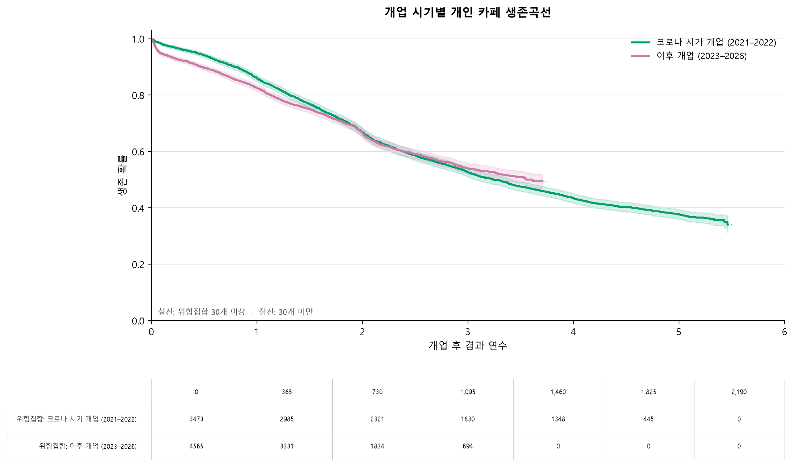

코로나 시기와 이후 개업 개인 카페의 Kaplan–Meier 생존곡선을 보여 준다.
점포 유형 비교에서는 개인 카페 8,038개(사건 3,726건, 1년 생존 84.0%, 3년 생존 52.9%); 프랜차이즈 3,463개(사건 523건, 1년 생존 96.7%, 3년 생존 85.0%) (전체 log-rank p=<0.001)였다. 이 그림은 전체 커피 점포 11,501개를 사용한 보조 비교이며, 개인 카페와 프랜차이즈의 운영 방식·입지 구성이 다를 수 있어 주 분석의 인과적 비교가 아니다.

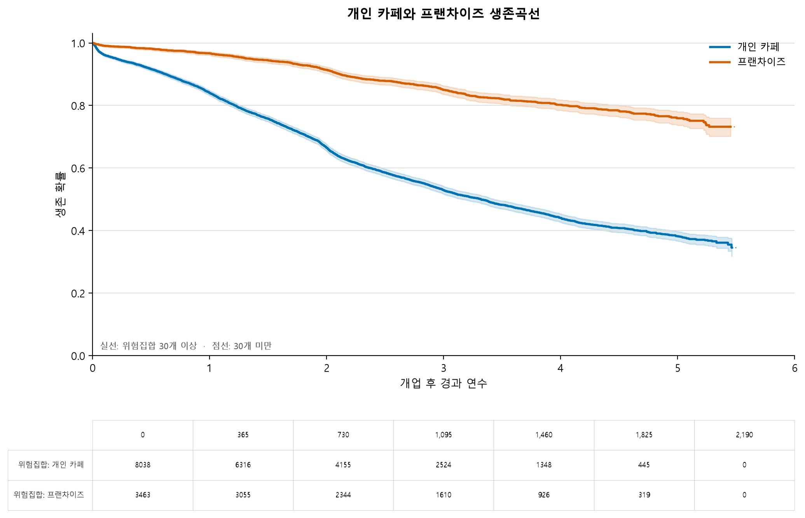

개인 카페와 프랜차이즈의 Kaplan–Meier 생존곡선을 보여 준다.
경쟁 비교의 관찰값은 다음과 같다.

- 전체 경쟁 카페 수 사분위: Q1 (0개 이상 5개 미만) 2,061개(사건 924건, 1년 생존 85.9%, 3년 생존 56.5%); Q2 (5개 이상 9개 미만) 1,947개(사건 909건, 1년 생존 84.9%, 3년 생존 52.5%); Q3 (9개 이상 16개 미만) 2,068개(사건 950건, 1년 생존 84.3%, 3년 생존 52.7%); Q4 (16개 이상) 1,827개(사건 883건, 1년 생존 80.7%, 3년 생존 49.6%) (전체 p=0.001, 순서 추세 p=<0.001)
- 개인 카페 경쟁 수 사분위: Q1 (0개 이상 4개 미만) 2,341개(사건 1,016건, 1년 생존 85.9%, 3년 생존 56.4%); Q2 (4개 이상 7개 미만) 1,938개(사건 891건, 1년 생존 85.8%, 3년 생존 54.4%); Q3 (7개 이상 11개 미만) 1,672개(사건 791건, 1년 생존 83.1%, 3년 생존 51.4%); Q4 (11개 이상) 1,952개(사건 968건, 1년 생존 80.8%, 3년 생존 48.8%) (전체 p=<0.001, 순서 추세 p=<0.001)
- 프랜차이즈 경쟁 수: 0개 1,999개(사건 946건, 1년 생존 85.4%, 3년 생존 55.0%); 1–2개 2,601개(사건 1,245건, 1년 생존 84.9%, 3년 생존 51.7%); 3–5개 1,768개(사건 758건, 1년 생존 85.5%, 3년 생존 54.7%); 6개 이상 1,535개(사건 717건, 1년 생존 79.0%, 3년 생존 50.5%) (전체 p=<0.001, 순서 추세 p=0.029)

프랜차이즈 경쟁의 원분포는 0개 1,999개; 1개 1,519개; 2개 1,082개; 3개 801개; 4개 549개; 5개 418개; 6개 313개; 7개 281개; 8개 200개; 9개 145개; 10개 132개; 11개 117개; 12개 92개; 13개 66개; 14개 54개; 15개 38개; 16개 33개; 17개 29개; 18개 17개; 19개 9개; 20개 5개; 21개 3개; 22개 1개이며, 0개가 한 구간에 집중된 특성을 보존하려고 `0 / 1–2 / 3–5 / 6개 이상`으로 구분했다. 그림의 방향은 경쟁 가설과 맞는지 확인하는 **기술적 신호**이며, 개업 시기와 수요가 집단별로 달라질 수 있으므로 Cox 모형에서 동시 조정이 필요하다.

전체 경쟁은 최저 사분위 56.5%에서 최고 사분위 49.6%로, 개인 경쟁은 56.4%에서 48.8%로 3년 생존확률이 낮아져 경쟁이 많을수록 폐업 위험이 높다는 가설과 같은 방향이다.

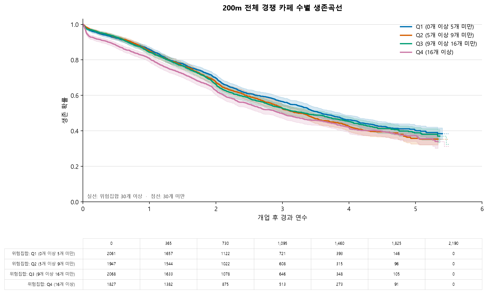

200m 전체 경쟁 카페 수 사분위별 생존곡선을 보여 준다.

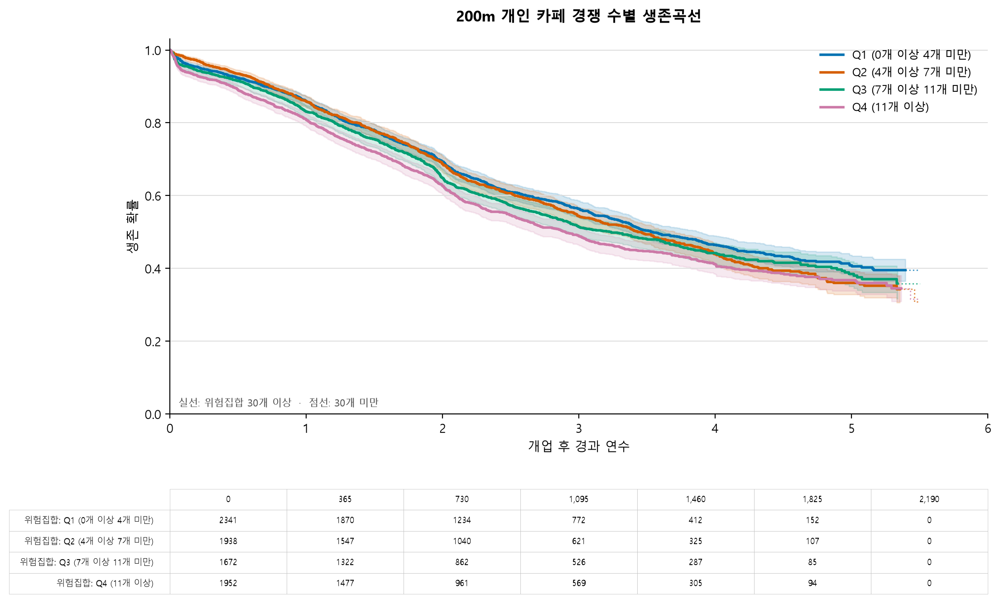

200m 개인 카페 경쟁 수 사분위별 생존곡선을 보여 준다.

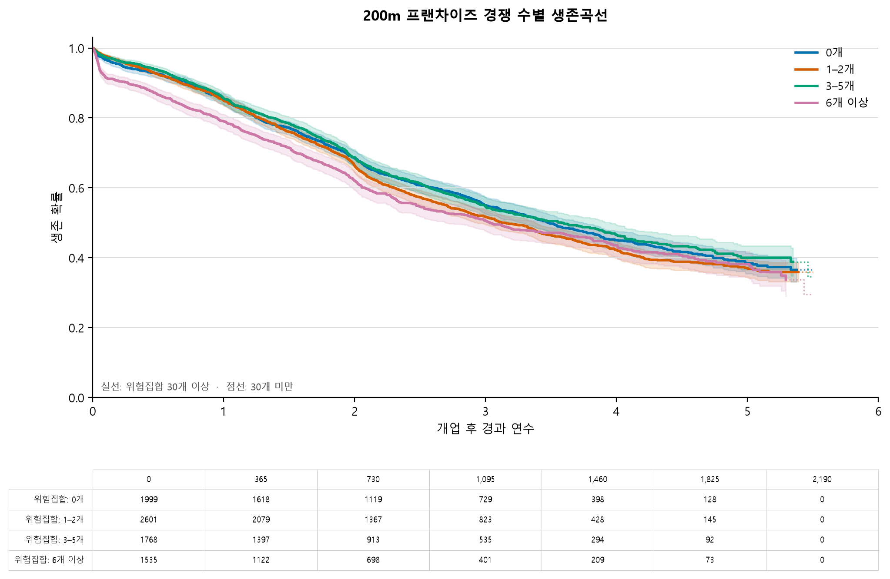

200m 프랜차이즈 경쟁 수 구간별 생존곡선을 보여 준다.
수요 지표의 비교는 다음과 같다.

- 개업 직전 분기 상권 총매출 사분위: Q1 (≤ 3,398,533,668) 1,845개(사건 848건, 1년 생존 85.7%, 3년 생존 53.5%); Q2 (3,398,533,668, 12,423,950,418] 1,845개(사건 882건, 1년 생존 85.1%, 3년 생존 53.1%); Q3 (12,423,950,418, 46,987,501,828] 1,844개(사건 852건, 1년 생존 84.2%, 3년 생존 51.7%); Q4 (> 46,987,501,828) 1,845개(사건 841건, 1년 생존 82.0%, 3년 생존 53.5%) (전체 p=0.651, 순서 추세 p=0.292)
- 유동인구 사분위: Q1 (≤ 591,548) 1,867개(사건 830건, 1년 생존 84.4%, 3년 생존 53.6%); Q2 (591,548, 1,183,662] 1,870개(사건 891건, 1년 생존 84.6%, 3년 생존 52.7%); Q3 (1,183,662, 2,053,162] 1,863개(사건 867건, 1년 생존 84.9%, 3년 생존 52.9%); Q4 (> 2,053,162) 1,865개(사건 879건, 1년 생존 83.4%, 3년 생존 52.4%) (전체 p=0.846, 순서 추세 p=0.472)
- 상주인구 사분위(참고): Q1 (≤ 1,474) 1,862개(사건 803건, 1년 생존 83.3%, 3년 생존 54.6%); Q2 (1,474, 2,878] 1,856개(사건 872건, 1년 생존 85.2%, 3년 생존 52.2%); Q3 (2,878, 5,000] 1,859개(사건 858건, 1년 생존 86.0%, 3년 생존 54.7%); Q4 (> 5,000) 1,855개(사건 920건, 1년 생존 83.0%, 3년 생존 50.2%) (전체 p=0.009, 순서 추세 p=0.029)

반면 총매출 최저·최고 사분위의 3년 생존확률은 각각 53.5%·53.5%, 유동인구는 53.6%·52.4%로 높은 수요가 생존을 높인다는 가설과 일관된 단변량 방향을 보이지 않았다.

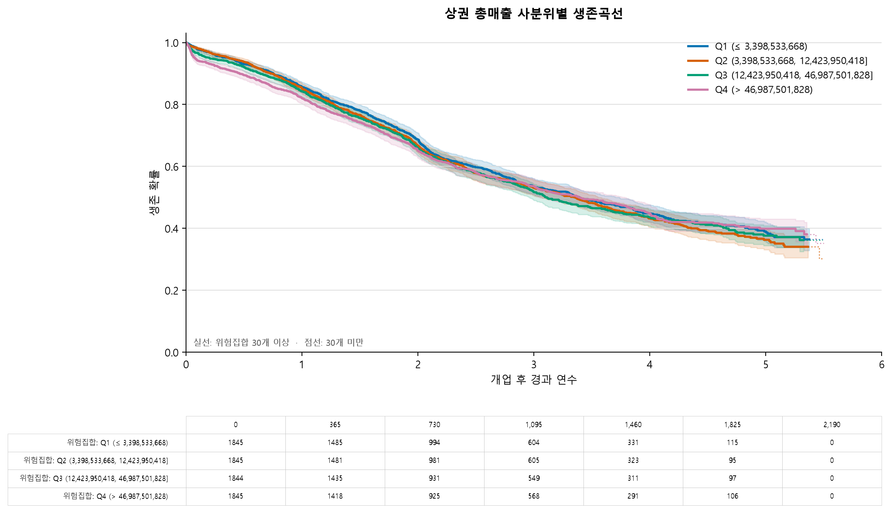

개업 직전 분기 상권 총매출 사분위별 생존곡선을 보여 준다.

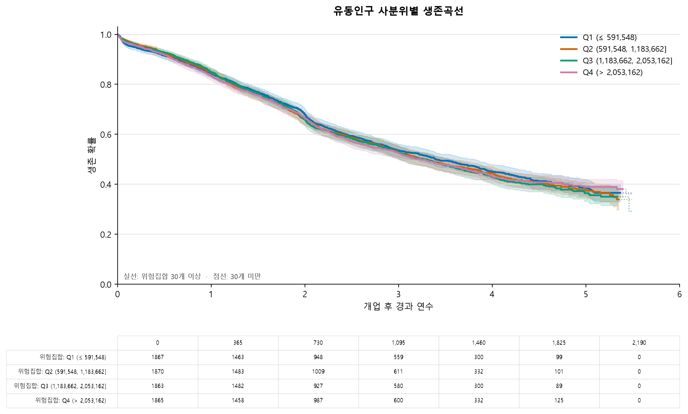

유동인구 사분위별 생존곡선을 보여 준다.

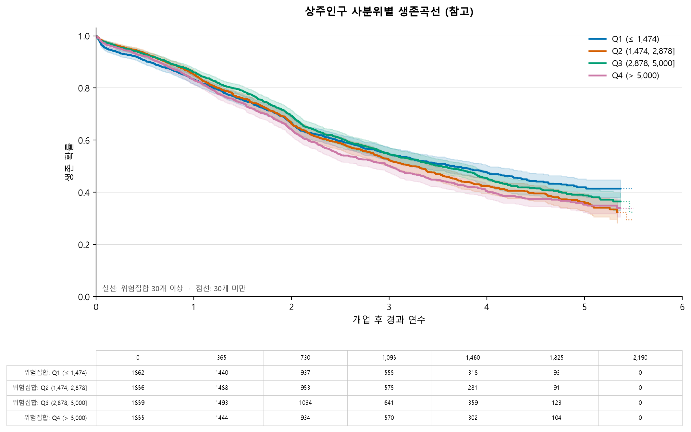

상주인구 사분위별 생존곡선을 보여 준다.
### 경쟁과 수요의 상쇄 점검

상쇄 그림은 `04_km_offset_sales.png`, `04_km_offset_floating.png`에 제시했다. 수요 사분위별 200m 전체 경쟁 수는 총매출에서 Q1 (≤ 3,398,533,668) 중앙값 5개·평균 6.9개; Q2 (3,398,533,668, 12,423,950,418] 중앙값 6개·평균 7.5개; Q3 (12,423,950,418, 46,987,501,828] 중앙값 10개·평균 11.6개; Q4 (> 46,987,501,828) 중앙값 18개·평균 18.6개 (Spearman ρ=0.531), 유동인구에서 Q1 (≤ 591,548) 중앙값 7개·평균 9.2개; Q2 (591,548, 1,183,662] 중앙값 8개·평균 9.8개; Q3 (1,183,662, 2,053,162] 중앙값 8개·평균 9.8개; Q4 (> 2,053,162) 중앙값 14개·평균 15.5개 (Spearman ρ=0.269)였다. 즉 수요가 높은 곳에 경쟁도 집중되는 양의 상관이 있어, 수요의 단변량 곡선 차이가 작게 보이는 한 가지 가능한 설명과 부합한다. 이는 보정 결과가 아니며 Cox에서 경쟁과 수요를 함께 넣어 확인할 사항이다.

경쟁만으로 200m 경쟁 합계 중앙값을 기준으로 나눈 고경쟁−저경쟁 생존율 차이는 총매출 표본에서 1년 -2.9%p · 2년 -3.7%p · 3년 -3.0%p (저경쟁 3,982개, 고경쟁 3,397개), 유동인구 표본에서 1년 -2.9%p · 2년 -3.6%p · 3년 -2.8%p (저경쟁 4,058개, 고경쟁 3,407개)였다. 수요 집단 안의 경쟁 차이와 나란히 보면, 같은 총매출 범위에서는 저수요에서 1년 -1.3%p · 2년 -2.4%p · 3년 -2.3%p, 고수요에서 1년 -3.3%p · 2년 -4.3%p · 3년 -4.3%p였고, 같은 유동인구 범위에서는 저수요에서 1년 -3.6%p · 2년 -4.8%p · 3년 -4.0%p, 고수요에서 1년 -2.4%p · 2년 -2.3%p · 3년 -1.7%p였다. 음수는 고경쟁 집단의 생존율이 낮다는 뜻이다. 2×2 칸별 점포 수는 총매출 표본에서 경쟁 낮음 · 총매출 낮음 2,796개; 경쟁 낮음 · 총매출 높음 1,186개; 경쟁 높음 · 총매출 낮음 894개; 경쟁 높음 · 총매출 높음 2,503개; 유동인구 표본에서 경쟁 낮음 · 유동인구 낮음 2,356개; 경쟁 낮음 · 유동인구 높음 1,702개; 경쟁 높음 · 유동인구 낮음 1,381개; 경쟁 높음 · 유동인구 높음 2,026개였다. 따라서 경쟁 낮음·수요 낮음과 경쟁 높음·수요 높음 칸에 점포가 상대적으로 많이 모이는지 표본 구성도 함께 확인할 수 있다. 반면 수요의 양끝 사분위 곡선 차이는 작고 일정하지 않아, 경쟁 집중과 수요의 반대 방향 연관이 서로 가려졌을 가능성을 시사할 뿐이다. 2×2 전체 log-rank p값은 총매출 0.093, 유동인구 0.116이며, 이 단변량 분류만으로 상쇄의 크기나 원인을 확정하지 않는다.

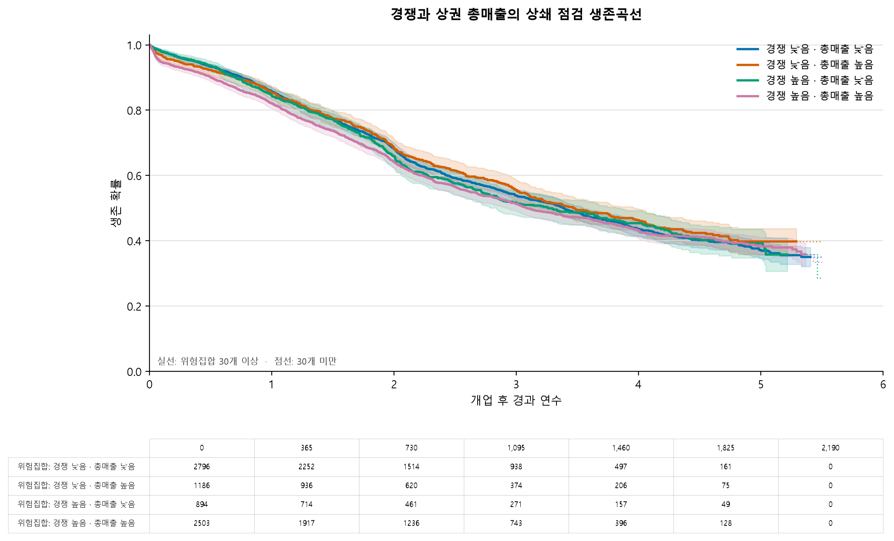

경쟁과 상권 총매출의 2×2 집단별 생존곡선을 보여 준다.

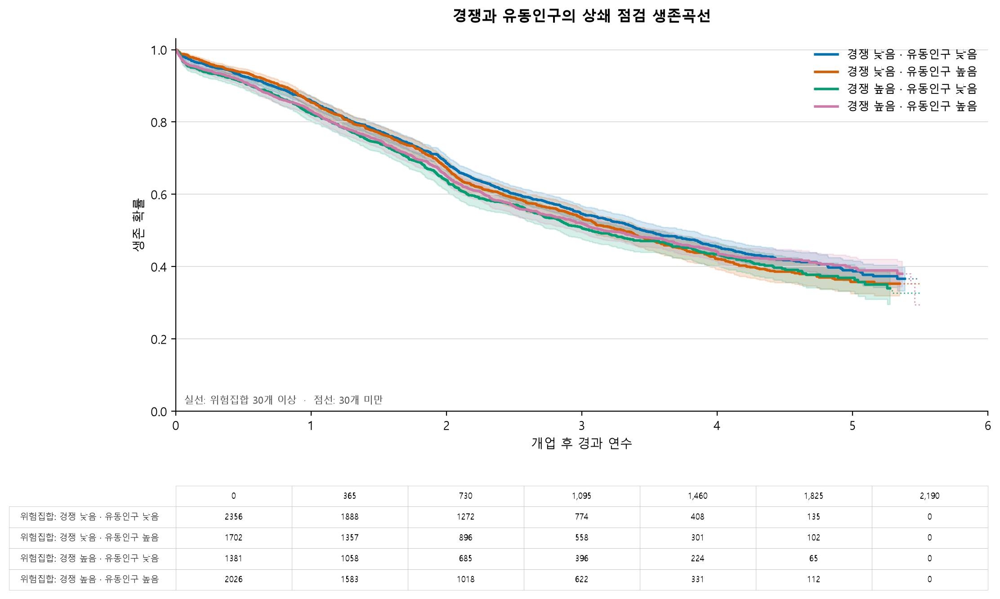

경쟁과 유동인구의 2×2 집단별 생존곡선을 보여 준다.
200m 이내 상권 배정 개인 카페의 상권 구분 곡선은 `04_km_trade_area_type.png`에 제시했다. 골목상권 3,862개(사건 1,811건, 1년 생존 85.2%, 3년 생존 53.0%); 발달상권 2,893개(사건 1,320건, 1년 생존 84.1%, 3년 생존 53.1%); 전통시장 428개(사건 193건, 1년 생존 87.9%, 3년 생존 53.5%); 관광특구 282개(사건 143건, 1년 생존 69.0%, 3년 생존 49.3%) 관광특구의 1년 생존확률은 다른 상권 구분보다 크게 낮지만, 상권 구성과 개업 시기 차이가 반영될 수 있어 해당 구분 자체의 효과로 해석하지 않는다.

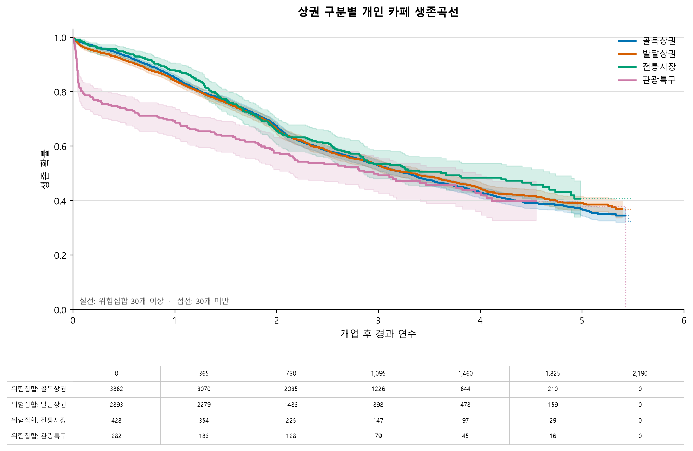

상권 구분별 개인 카페 생존곡선을 보여 준다.
재인허가 통합 강건성 곡선은 주 분석 개인 카페와 재인허가 통합 개인 카페 7,926개를 겹쳐 제시했다(`04_km_robustness_relicense.png`). 통합 표본−주 분석 표본의 생존율 차이는 1년 +0.3%p · 2년 +0.6%p · 3년 +0.5%p로 작으며, 주 분석의 인허가 단위 정의를 바꾸지 않고 민감도만 점검한다.

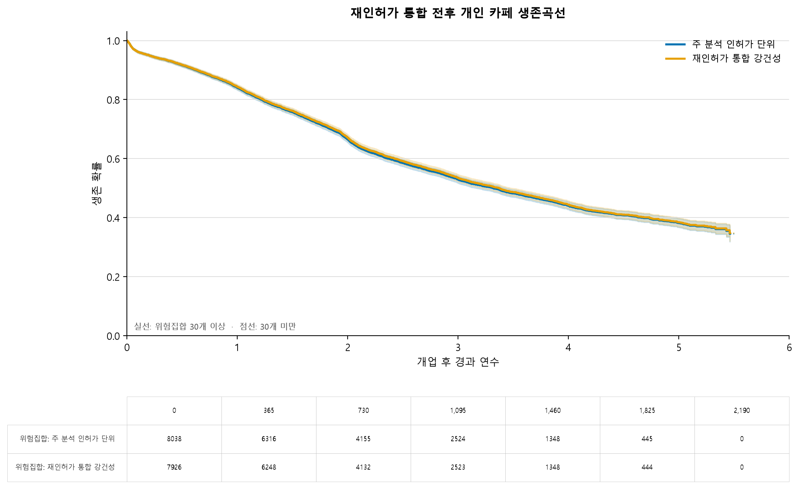

인허가 단위와 재인허가 통합 강건성 표본의 생존곡선을 비교한다.
### 경쟁·수요 집단의 개업 시기 구성

경쟁·수요 집단의 개업 시기 비율은 `docs/tables/04_km_opening_period_mix.csv`에 저장했고, 아래에 함께 제시했다. 이후 개업 비율의 집단 간 범위는 전체 경쟁 수 54.0~59.7%, 개인 경쟁 수 55.1~58.6%, 프랜차이즈 경쟁 수 51.1~64.4%, 총매출 52.6~60.3%, 유동인구 54.4~59.9%다. 이 차이가 있는 비교에서는 KM 차이 일부가 개업 시기 구성에서 온 것일 수 있으므로, Cox에서 개업 연도로 층화해 통제한다.

| 비교 | 집단 | 코로나 시기 개업 | 이후 개업 |
| --- | --- | ---: | ---: |
| 프랜차이즈 경쟁 수 | 0개 | 977 (48.9%) | 1,022 (51.1%) |
| 프랜차이즈 경쟁 수 | 1–2개 | 1,195 (45.9%) | 1,406 (54.1%) |
| 프랜차이즈 경쟁 수 | 3–5개 | 702 (39.7%) | 1,066 (60.3%) |
| 프랜차이즈 경쟁 수 | 6개 이상 | 547 (35.6%) | 988 (64.4%) |
| 개인 경쟁 수 | Q1 (0개 이상 4개 미만) | 970 (41.4%) | 1,371 (58.6%) |
| 개인 경쟁 수 | Q2 (4개 이상 7개 미만) | 871 (44.9%) | 1,067 (55.1%) |
| 개인 경쟁 수 | Q3 (7개 이상 11개 미만) | 746 (44.6%) | 926 (55.4%) |
| 개인 경쟁 수 | Q4 (11개 이상) | 834 (42.7%) | 1,118 (57.3%) |
| 전체 경쟁 수 | Q1 (0개 이상 5개 미만) | 902 (43.8%) | 1,159 (56.2%) |
| 전체 경쟁 수 | Q2 (5개 이상 9개 미만) | 895 (46.0%) | 1,052 (54.0%) |
| 전체 경쟁 수 | Q3 (9개 이상 16개 미만) | 887 (42.9%) | 1,181 (57.1%) |
| 전체 경쟁 수 | Q4 (16개 이상) | 737 (40.3%) | 1,090 (59.7%) |
| 유동인구 | Q1 (≤ 591,548) | 748 (40.1%) | 1,119 (59.9%) |
| 유동인구 | Q2 (591,548, 1,183,662] | 853 (45.6%) | 1,017 (54.4%) |
| 유동인구 | Q3 (1,183,662, 2,053,162] | 835 (44.8%) | 1,028 (55.2%) |
| 유동인구 | Q4 (> 2,053,162) | 821 (44.0%) | 1,044 (56.0%) |
| 상주인구(참고) | Q1 (≤ 1,474) | 754 (40.5%) | 1,108 (59.5%) |
| 상주인구(참고) | Q2 (1,474, 2,878] | 776 (41.8%) | 1,080 (58.2%) |
| 상주인구(참고) | Q3 (2,878, 5,000] | 876 (47.1%) | 983 (52.9%) |
| 상주인구(참고) | Q4 (> 5,000) | 844 (45.5%) | 1,011 (54.5%) |
| 총매출 | Q1 (≤ 3,398,533,668) | 814 (44.1%) | 1,031 (55.9%) |
| 총매출 | Q2 (3,398,533,668, 12,423,950,418] | 875 (47.4%) | 970 (52.6%) |
| 총매출 | Q3 (12,423,950,418, 46,987,501,828] | 802 (43.5%) | 1,042 (56.5%) |
| 총매출 | Q4 (> 46,987,501,828) | 732 (39.7%) | 1,113 (60.3%) |

## Cox 설계에서 확인할 점

- **수요 투입 전후 경쟁 계수:** 경쟁만 넣은 모형의 경쟁 계수와 총매출·유동인구를 함께 넣은 모형의 계수를 비교해, 수요와의 공간적 동반 분포를 조정했을 때 경쟁의 방향과 크기가 얼마나 달라지는지 확인한다.
- **경쟁×수요 상호작용:** 경쟁의 연관이 저수요·고수요 입지에서 같은지 확인한다. 상쇄 그림의 집단별 차이는 기술적 비교이므로, 상호작용항의 추정치와 신뢰구간으로 별도 검증한다.
- **개업 연도 층화:** 개업 연도별 시장 환경과 관측기간 차이를 통제하도록 개업 연도 층화 Cox 모형을 우선 검토한다.
- **비례위험 가정:** 고경쟁·고매출 집단 곡선은 개업 초기 몇 달 안에 먼저 떨어지는 모습이 보이므로, Schoenfeld 잔차와 시간상호작용으로 비례위험 가정을 점검한다. 위반 시 초기와 이후 위험이 다른 시간가변 효과 또는 층화 모형을 검토한다.
- **관광특구 처리:** 관광특구의 낮은 초기 생존이 경쟁 효과와 혼동되지 않도록 상권 구분을 보정하고, 관광특구 제외 민감도 분석도 함께 제시한다.
- **프랜차이즈 경쟁의 비선형성:** 프랜차이즈 경쟁 6개 이상 구간의 생존 차이가 앞선 구간과 선형적으로 이어지는지 제한적 스플라인 또는 구간 더미로 확인한다.

## 방법과 검증

### 표본과 변수

- 전체·개업 시기·경쟁·수요·상권 구분의 기본 비교는 개인 카페(`is_franchise == False`)를 썼다. 점포 유형 비교만 프랜차이즈를 포함한 전체 커피 점포를 사용했다.
- 경쟁 비교는 좌표와 해당 경쟁 변수가 있는 개인 카페만, 수요 및 상권 구분 비교는 200m 이내 최근접 상권 배정(`trdar_within_200m == True`)과 해당 변수의 비결측을 모두 만족한 개인 카페만 포함했다. 따라서 비교별 표본 수는 달라질 수 있다.
- 매출·유동인구·상주인구의 사분위 경계는 각각의 유효 비교 표본에서 계산했다. 연속형 구간은 `(a, b]`, 경쟁 수처럼 정수형인 구간은 실제 포함 범위(예: `0개 이상 5개 미만`)로 표시했다. 경계값은 요약 CSV의 `group_rule`에 기록했다. 상권 총매출은 개업 직전 분기 값이며, 상주인구는 참고용으로 함께 그렸다.
- 관측 종료일은 2026-09-30이며 폐업하지 않은 점포는 우측 중도절단으로 처리했다. 재인허가 강건성은 `robust_relicense_in_sample`과 이에 대응하는 생존기간·사건 변수를 사용했다.

### 곡선과 검정

각 집단에 Kaplan–Meier 생존곡선과 95% 신뢰구간을 표시했다. 중앙 생존기간 신뢰구간은 생존 신뢰구간의 하한·상한 곡선이 각각 0.5를 처음 지나는 시점으로 계산했다. 위험집합이 30개 미만이 되는 시점 뒤의 곡선은 점선으로 표시해 추정의 불안정성을 드러냈으며, 그림 아래에는 각 연수 시점의 위험집합 수를 넣었다. 전체 log-rank 검정은 두 집단 이상 비교마다 수행했고, 사분위·경쟁 구간처럼 순서가 있는 집단에는 저값→고값의 명시적 `group_order`에 따른 1자유도 순서 log-rank 추세검정도 추가했다. 검정은 집단 간 생존곡선의 차이를 요약할 뿐 공변량을 조정하지 않는다.

## 산출물과 유의사항

- 그림: `docs/figures/04_km_*.png`
- 요약표: `docs/tables/04_km_summary.csv`
- 개업 시기 구성표: `docs/tables/04_km_opening_period_mix.csv`
- 상쇄 진단표: `docs/tables/04_km_offset_diagnostics.csv`
- 재현 스크립트: `src/04_kaplan_meier.py`

개업 시기별 관측기간 차이, 경쟁·수요 집단의 개업 시기 구성 차이, 그리고 KM의 비조정 비교라는 한계 때문에 이 결과만으로 폐업 위험의 원인을 판단하지 않는다. 상쇄 진단표에는 수요 사분위별 경쟁 분포, 경쟁만으로 나눈 생존율 차이, 2×2 칸별 점포 수를 함께 기록했다. 다음 Cox 단계에서는 개업 연도와 수요·경쟁 공변량을 함께 조정해 이 방향이 유지되는지 검증해야 한다.
