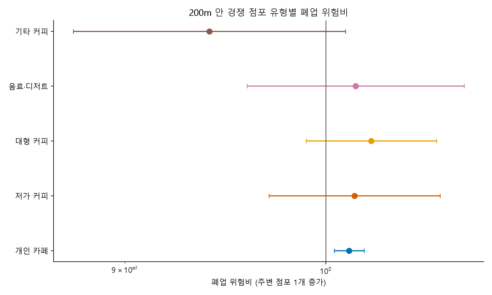
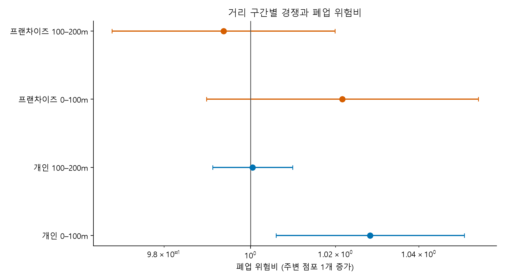
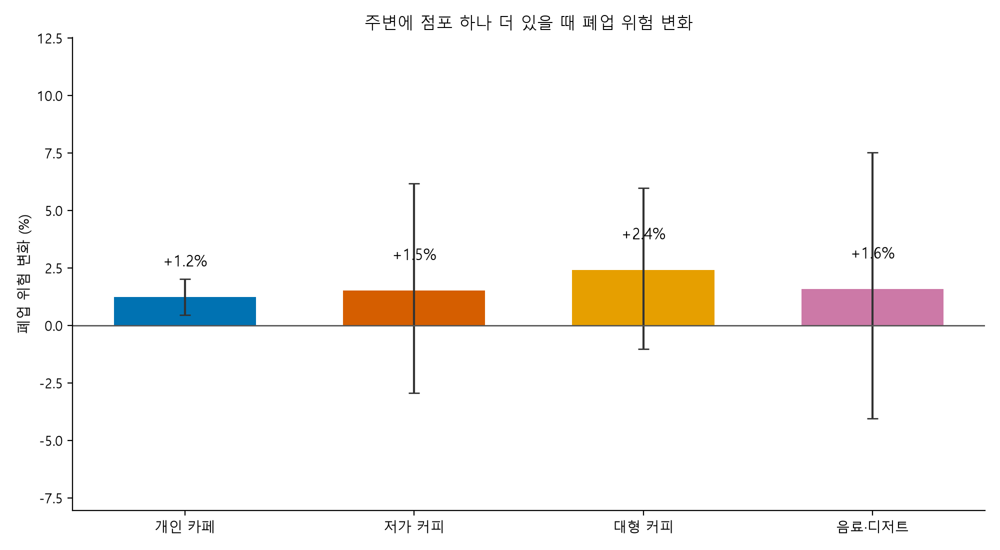

# 프랜차이즈 유형·거리별 경쟁 Cox 분석

## 무엇을 알 수 있나

200m 안 프랜차이즈를 저가 커피·대형 커피·음료·디저트·기타 커피로 나누어도, 각 유형과 개인 카페 폐업 위험의 연관은 신뢰구간만으로 확정하기 어려웠다. 유형별 1개당 위험비(95% 신뢰구간)는 저가 커피 1.015 (0.971–1.062); 대형 커피 1.024 (0.990–1.060); 음료·디저트 1.016 (0.959–1.075); 기타 커피 0.941 (0.876–1.010)이다. 따라서 기존에 프랜차이즈 전체로 연관이 뚜렷하지 않았던 이유를 **유형별 효과가 서로 지워졌기 때문이라고 확인할 근거는 없다.**

예비 창업자가 이 자료만으로 프랜차이즈 근처를 일괄적으로 피해야 한다고 말할 수는 없다. 반대로 안전하다고도 말할 수 없다. 이 분석은 같은 시점·입지 특성이 비슷한 점포들에서의 연관이며, 프랜차이즈가 폐업을 일으킨다는 인과 결론은 아니다.

개인 카페 경쟁의 계수는 주 분석 0.0109에서 유형 모형 0.0122로 변했고, 1개당 위험비는 1.012(1.004–1.020)였다. 저가 커피와 대형 커피의 계수가 같다는 가설도 기각하지 못했다(Wald p=0.779). 즉 두 유형 사이의 차이 역시 이 자료에서는 뚜렷하지 않다.

0개인 비율은 음료·디저트 72.3%, 기타 커피 70.6%로 높았다. 그래서 유형별로 한 곳이라도 있는지를 비교한 모형도 함께 적합했다. 이 보조 모형에서는 기타 커피가 하나 이상 있는 경우만 위험비 0.856(0.770–0.952)로 나타났지만, 개수 모형의 신뢰구간은 1을 포함한다. 다른 유형·거리·500m 반경 결과와 함께 볼 때, 이를 특정 유형이 위험을 낮춘다는 확정 결론으로 해석하지 않았다.

프랜차이즈는 0–100m의 위험비 1.022(0.990–1.055), 100–200m의 위험비 0.994(0.968–1.020)였고 구간 간 차이도 뚜렷하지 않았다(Wald p=0.209). 개인 카페는 가까운 0–100m에서만 1.028(1.006–1.051)로 연관됐으며, 두 거리 구간의 차이는 관찰됐다(p=0.043).

그림은 200m 안의 경쟁 점포가 한 곳 더 있을 때의 추정 위험비와 불확실성을 보여 준다.

그림은 바로 옆과 100–200m 구간의 경쟁 연관을 비교한다.

그림은 주변 점포가 하나 늘어날 때의 폐업 위험 변화 추정치를 쉽게 비교한다.

## 방법과 검증

주 분석과 동일하게 개인 카페·200m 이내 상권 배정의 완전 사례 표본을 사용하고, 개업연도 층화·배정 상권 군집 강건 표준오차·상권 커피 점포 수와 결측 표시·로그 총매출·로그 유동인구·로그 상주인구·상권 구분을 통제했다. 최종 표본은 7,351개, 사건은 3,411건이다.

프랜차이즈 경쟁은 개업일보다 앞서 개업했고 그날 영업 중인 점포만 세어 미래 정보를 쓰지 않았다. 네 유형 200m 합계, 프랜차이즈 거리 구간 합계, 개인 카페 거리 구간 합계는 기존 200m 변수와 점포별로 모두 일치했다. 검증 표는 `../tables/05_cox_franchise_types_count_validation.csv`에 있다.

브랜드 분류는 지시문 명시 목록을 우선 적용했다. 목록 밖 커피 체인은 가격대를 추측하지 않고 기타 커피로 두었고, 상호만으로 주력 상품 판단이 애매한 브랜드는 검수 필요으로 표시했다. 전체 분류와 검수 대상은 `src/franchise_brand_types.csv`, `../review/05_franchise_brand_types_review.csv`에 있다.

기타 커피를 저가 또는 대형 커피에 합친 민감도 분석과 500m 반경 분석에서도 어떤 유형의 95% 신뢰구간도 1보다 완전히 크거나 작지 않았다. 유형별 경쟁과 로그 유동인구의 상호작용에서는 대형 커피 상호작용 항의 위험비 0.950(0.905–0.998)이었으나, 저가 커피 항은 0.997(0.961–1.035)이었다. 이는 보조 분석의 한 계수이며, 다중 비교와 관찰자료의 한계 때문에 유동인구가 대형 체인의 연관을 바꾼다고 단정하지 않았다.

상세 수치: 개수 분포 `../tables/05_cox_franchise_types_count_distribution.csv`, 계수 `../tables/05_cox_franchise_types_coefficients.csv`, Wald 검정 `../tables/05_cox_franchise_types_wald_tests.csv`, 강건성 결과 `../tables/05_cox_franchise_types_robustness.csv`, 창업자 판단 요약 `../tables/05_cox_franchise_types_judgment.csv`.
