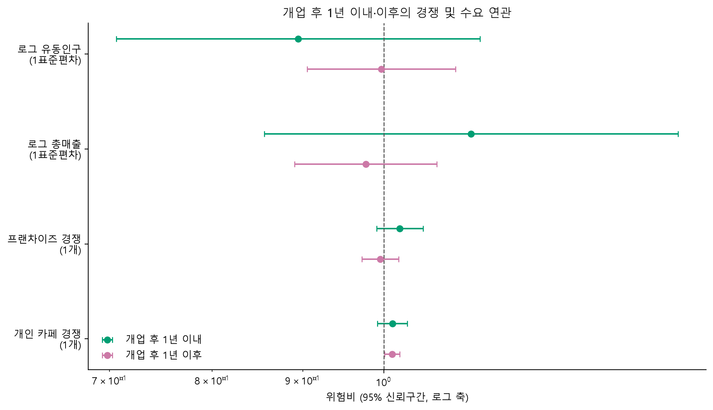
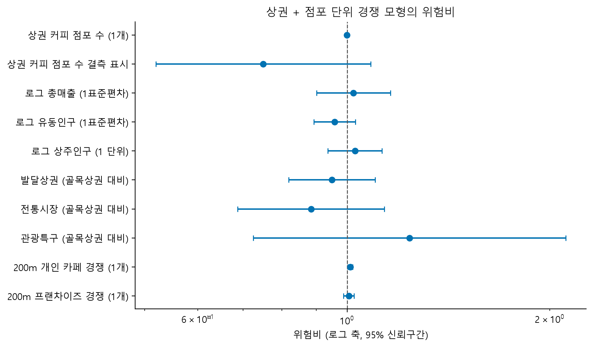
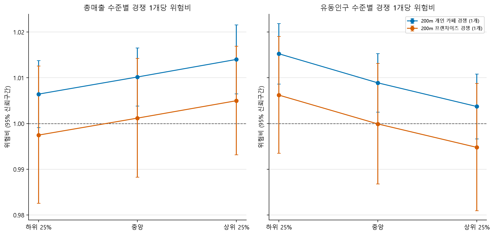

# 개업 시점 고정 변수 Cox 주 분석 보고서

## 주요 결과

개업 직전 상권 정보와 개업 시점의 반경 200m 경쟁을 함께 넣은 Cox 분석에서, 최종 공통 표본은 개인 카페 7,351개(폐업 사건 3,411건)였다. 모든 결과는 개업연도로 층화하고 배정 상권 기준 군집 강건 표준오차를 사용했으며, 연관성으로만 해석한다.

### 경쟁

상권 변수만 포함한 모형에 200m 점포 단위 경쟁을 더하면 부분 AIC는 47458.0에서 47446.9로 -11.1 변했고, Harrell's C는 0.508에서 0.521로 +0.014 변했다. 우도비 검정은 χ²=15.14, df=2, p=<0.001였다.
점포 단위 경쟁을 함께 조정한 모형에서 개인 카페 경쟁 1개당 위험비는 1.011 (1.003–1.019) (p=0.008), 프랜차이즈 경쟁 1개당은 1.006 (0.988–1.024) (p=0.526)였다. 사분위 범위(IQR)당 위험비는 계수 표에 함께 제시했다.
개인 경쟁의 추정치는 1보다 크고 신뢰구간도 1을 넘어서, KM에서 개인·전체 경쟁이 많을수록 생존확률이 낮았던 방향과 일치한다. 반면 프랜차이즈 경쟁은 신뢰구간이 1을 포함해 KM의 구간별 차이가 독립적인 선형 연관으로 이어진다고 보기 어렵다. 단, 이 관찰자료는 입지 선택과 미관측 요인을 제거하지 못하므로 경쟁 자체의 효과로 단정하지 않는다.

지연 진입을 쓴 군집 강건 시간구간 모형에서도 개인 경쟁은 개업 후 1년 이내 HR 1.011 (0.992–1.031), 이후 HR 1.011 (1.001–1.021)였고, 두 구간 계수 차이 Wald p=0.971였다. 프랜차이즈 경쟁은 첫해 HR 1.021 (0.991–1.053), 이후 HR 0.995 (0.972–1.019)였으며, 두 구간 차이는 p=0.193였다. 개인 경쟁의 점추정은 두 구간에서 비슷했고, 프랜차이즈 경쟁의 점추정은 첫해에 더 컸다. 다만 프랜차이즈 경쟁의 두 구간 신뢰구간은 모두 1을 포함하고 계수 차이도 뚜렷하지 않아 시간에 따른 차이를 확정할 수는 없다.

그림은 개인 경쟁의 점추정은 두 구간에서 비슷하고, 프랜차이즈 경쟁과 수요의 점추정 차이는 첫해에 더 큰 방향임을 보여 준다.

그림은 주 분석에서 개인 경쟁의 위험비가 1보다 크고 프랜차이즈 경쟁의 신뢰구간은 1을 포함함을 보여 준다.

### 수요

경쟁과 상권 구분을 함께 넣은 모형에서 로그 총매출 1표준편차당 위험비는 1.019 (0.918–1.130) (p=0.729), 로그 유동인구 1표준편차당은 0.951 (0.876–1.031) (p=0.224)였다.
두 수요 지표의 신뢰구간이 모두 1을 포함해, 총매출·유동인구 사분위별 생존 차이가 작고 방향도 일관되지 않았던 KM 관찰과 대체로 같다. 수요가 높아 폐업 위험이 달라진다는 인과 해석은 하지 않는다.

시간구간 모형에서는 로그 총매출이 첫해 HR 1.120 (0.856–1.466), 이후 HR 0.977 (0.890–1.072)였고(구간 차이 p=0.281), 로그 유동인구는 첫해 HR 0.895 (0.706–1.133), 이후 HR 0.997 (0.905–1.098)였다(구간 차이 p=0.481). 점추정은 첫해와 이후에 다른 방향을 보였지만, 군집 강건 신뢰구간과 계수 차이 Wald 검정은 뚜렷하지 않았다. 따라서 주 분석의 평균 위험비가 1에 가까운 결과가 시간에 따른 차이를 평균한 것이라고 단정할 수는 없다.

### 상쇄: 가려짐과 완충

수요 투입 전후 경쟁 계수 변화는 `05_cox_competition_changes.csv`에 기록했다. 개인 경쟁의 위험비 변화율은 +0.1%, 프랜차이즈 경쟁은 -0.0%로 매우 작았다. 따라서 KM에서 보인 수요·경쟁의 동반 분포가 경쟁 계수를 크게 가렸다는 근거는 이 모형에서 뚜렷하지 않다.
경쟁 합계×표준화 로그 총매출 상호작용의 위험비는 1.005 (0.997–1.014) (p=0.234)로 완충의 근거가 뚜렷하지 않았다. 경쟁 합계×표준화 로그 유동인구는 0.990 (0.982–0.999) (p=0.024)로, 유동인구가 높은 곳에서 경쟁과 높은 폐업 위험의 연관이 약해지는 방향이었다. 수요 수준별 조건부 경쟁 위험비는 `05_cox_demand_competition_hr.csv`에 수록했다. 이는 유동인구의 저수요 집단에서 고경쟁의 생존율이 더 낮고 고수요 집단에서는 차이가 작았던 KM 그림과 방향이 같다. 총매출에서는 같은 완충 패턴이 확인되지 않았다. 상호작용은 다른 입지 특성과 함께 관찰된 연관이므로, 수요가 경쟁의 결과를 완충한다고 인과적으로 해석하지 않는다.

그림은 유동인구가 높은 상권에서 경쟁의 양(+) 연관이 약해지는 방향을 보여 준다.
## 방법과 검증

### 표본과 변수 처리

주 분석은 프랜차이즈가 아닌 카페 중 최근접 상권 경계 안쪽 200m에 배정된 점포로 시작했다. 상권 커피 점포 수 및 프랜차이즈 점포 수의 행 부재는 0으로 채우고 `trdar_coffee_stores_missing`을 넣었다. 다른 투입 변수의 결측은 완전 사례에서 제외했으며, 모든 주 모형은 동일한 최종 표본을 사용했다. 표본 흐름은 `05_cox_sample_flow.csv`에 있다.
총매출·유동인구·상주인구에는 자연로그를 적용했다. 0 이하 값은 없었으므로 로그 변환을 위한 추가 제외는 없었다. 총매출과 유동인구는 평균 0·표준편차 1로 표준화했다(로그 총매출 평균 23.211, 표준편차 1.842; 로그 유동인구 평균 13.877, 표준편차 1.031). 상권 구분은 골목상권을 기준 범주로 더미 처리했다.
2026년 사건이 30건 미만이어서 2025년과 합침. 배정 상권 코드로 군집 강건 표준오차를 계산했고, 동일한 점포의 이전 운영 여부(`has_predecessor_same_site`)는 모형에 넣지 않았다.

### 모형 비교와 진단

상권 모형, 상권+점포 단위 경쟁, 경쟁만, 경쟁+수요, 상호작용 모형을 각각 적합했다. 비례위험 재검정은 군집 강건 분산을 쓰지 않은 같은 층화 Cox 적합에서 수행했다. 기존 표는 군집 강건 적합을 `proportional_hazard_test`에 넘겨 scaled Schoenfeld 잔차의 척도가 맞지 않았고, 그 결과 p값이 비정상적으로 0.9 부근에 집중됐다.
lifelines 0.30.3의 `rank` 변환은 시간의 평균순위가 아니라 이벤트 표시의 누적합(`np.cumsum(events)`)으로 구현되어 있으며, 소스에도 ‘hacky’라고 명시돼 있다. 따라서 동순위 사건과 층화가 있는 이 자료에서 rank 검정은 직접 계산한 사건시점 평균순위 상관과 같은 검정이 아니다. rank 결과는 비례위험 판단 근거에서 제외하고, KM·log 변환과 scaled Schoenfeld 잔차-사건시점 순위 상관을 함께 사용했다.
상권+점포 단위 경쟁 모형에서 로그 총매출은 KM p=0.011, log p<0.001, 직접 상관 r=-0.047 (p=0.006)으로 시간에 따른 연관이 확인됐다. 경쟁 변수와 로그 유동인구는 이 세 점검에서 뚜렷한 위반이 확인되지 않았다. 상호작용 모형에서는 총매출·유동인구 완충항의 KM·log 검정도 p<0.05여서, 시간구간 모형으로 보완했다.
분할 자료에서 시간 상호작용을 넣지 않은 적합은 원 주 분석 계수와 최대 절대차 1e-8 미만으로 일치해, 지연 진입 분할이 위험집합과 사건 수를 보존함을 확인했다. 180일·365일·730일 기준 민감도와 계수 차이 Wald 검정은 `05_cox_time_split_effects.csv`에 수록했다.
프랜차이즈 경쟁은 0 / 1–2 / 3–5 / 6개 이상 더미로 바꾼 보조모형을 `05_cox_coefficients.csv`에 함께 수록했다. 수요 수준별 조건부 경쟁 위험비는 다른 수요 변수를 평균(표준화 0)에 고정해 계산했다. 투입 변수 VIF의 최댓값은 3.81이며 전체 값은 `05_cox_vif.csv`에 있다.
### 민감도 분석

관광특구를 제외한 표본에서 상권+점포 단위 경쟁 및 상호작용 모형을 다시 적합했고, 상권 커피 점포 수 원결측 점포를 제외한 상권+점포 단위 경쟁 모형도 적합했다. 해당 경쟁 계수 비교는 `05_cox_sensitivity.csv`에 저장했다. 이 점검은 특정 상권 유형이나 0 채움 처리에 결과가 좌우되는지 확인하기 위한 것이며, 주 분석 표본·정의를 바꾸지 않는다.

## 산출물

- 계수·위험비: `docs/tables/05_cox_coefficients.csv`
- 모형 적합도·표본 흐름·VIF·비례위험·민감도: `docs/tables/05_cox_*.csv`
- 그림: 경쟁·수요·시간구간 결과 문단에 삽입
