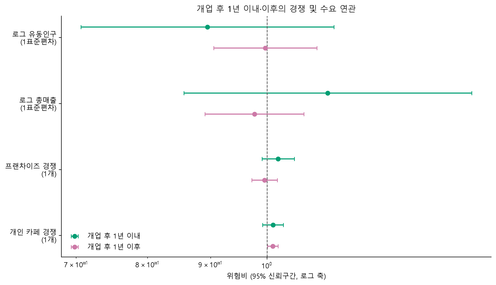
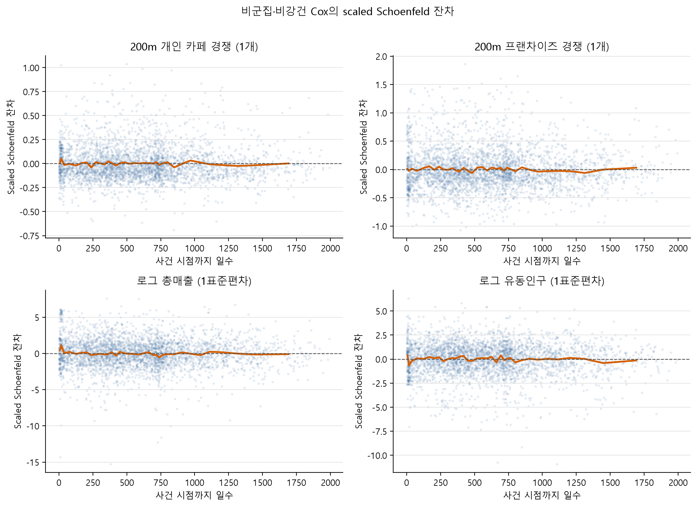
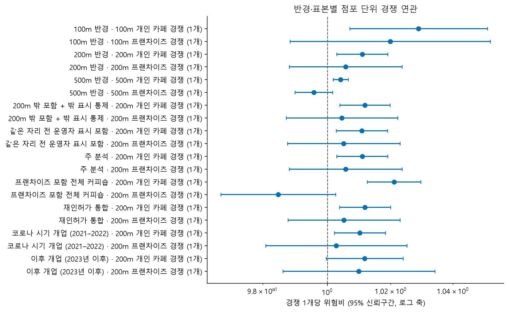

# Cox 비례위험 재검정과 강건성 검증 보고서

## 주요 결과

비례위험 재검정에서 lifelines의 `rank` 시간변환이 사건시점의 평균순위와 다른 누적 사건순서로 구현된 사실을 확인했다. 이 때문에 rank p값은 판단에서 제외하고 KM·log 변환 및 직접 계산한 scaled Schoenfeld 잔차-시간 순위 상관으로 판단했다. 로그 총매출은 이 진단에서 시간에 따른 연관이 달랐지만, 군집 강건 시간구간 모형의 구간 차이 검정은 이를 뚜렷하게 확인하지 못했다.

### 비례위험과 개업 초기

`rank` 구현은 `np.cumsum(events)`이며, lifelines 소스가 이를 ‘hacky’라고 명시한다. 따라서 동순위 사건이 있는 이 분석에서 기존 rank p값 0.86–0.99는 평균순위 상관과 직접 비교할 수 없다. 상권+점포 단위 경쟁 모형에서 로그 총매출은 KM p=0.011, log p<0.001, 직접 상관 p=0.006으로 시간 의존성을 보였다. 경쟁 변수와 로그 유동인구에서는 세 점검이 일관되게 뚜렷한 시간 의존성을 보이지 않았다.

365일 절단 군집 강건 모형의 첫 구간 결과는 200m 개인 카페 경쟁 (1개) HR 1.011 (0.992–1.031); 200m 프랜차이즈 경쟁 (1개) HR 1.021 (0.991–1.053); 로그 총매출 (1표준편차) HR 1.120 (0.856–1.466); 로그 유동인구 (1표준편차) HR 0.895 (0.706–1.133)이고, 이후 구간 결과는 200m 개인 카페 경쟁 (1개) HR 1.011 (1.001–1.021); 200m 프랜차이즈 경쟁 (1개) HR 0.995 (0.972–1.019); 로그 총매출 (1표준편차) HR 0.977 (0.890–1.072); 로그 유동인구 (1표준편차) HR 0.997 (0.905–1.098)이다.
개인 경쟁은 두 구간의 위험비가 비슷했다. 프랜차이즈 경쟁·로그 총매출·로그 유동인구는 점추정상 첫해에 더 큰 차이를 보였지만, 각 구간의 군집 강건 신뢰구간은 1을 포함했다. 계수 차이 Wald p는 각각 0.193, 0.281, 0.481였다. 이 결과만으로 주 분석의 평균 위험비가 시간에 따라 다른 연관을 평균한 결과라고 결론내릴 수는 없지만, 점추정의 시간 패턴은 비례위험 진단을 보완한다.

그림은 개인 경쟁의 점추정이 두 구간에서 비슷하고, 프랜차이즈 경쟁과 수요의 점추정 차이가 첫해에 더 큰 방향임을 보여 준다. 다만 구간별 군집 강건 신뢰구간은 모두 1을 포함한다.

완충 상호작용에서도 전체 경쟁×로그 유동인구는 첫해 HR 0.986 (0.968–1.003), 이후 HR 0.995 (0.989–1.000)였고, 구간 차이 p=0.367였다. 유동인구가 경쟁의 양(+) 연관을 약하게 하는 방향이 첫해에 더 집중됐는지 점검했지만, 구간 차이 검정은 뚜렷하지 않았다. 관찰자료이므로 인과적 완충으로 해석하지 않는다.

그림은 경쟁·수요 변수의 잔차가 사건시점에 따라 어떻게 달라지는지 보여 주며, 로그 총매출의 시간 의존성 판단을 보완한다.

### 반경과 표본을 바꾼 결과

개인 경쟁의 양(+) 연관은 100m·200m·500m 반경과 표본 변형에서도 같은 방향이었다. 반면 프랜차이즈 경쟁의 신뢰구간은 대체로 1을 포함해 독립적 연관이 강건하지 않았다. 반경·표본별 계수, IQR 위험비, 완충 조건부 위험비는 `05_cox_robustness_radius_*.csv`, `05_cox_robustness_sample_*.csv`에 수록했다.

그림은 개인 경쟁의 양(+) 연관이 반경과 표본을 바꿔도 유지되는 방향을 보여 준다.

## 방법과 검증

### 지연 진입 시간구간 모형

주 분석과 같은 7,351개 완전 사례(사건 3,411건)를 각 기준일 전·후 행으로 나눴다. 후행 행은 `entry_col`을 기준일로 두어 그 시점까지 생존한 점포만 위험집합에 진입시켰다. 모든 모형은 개업연도 층화와 배정 상권 군집 강건 샌드위치 분산을 사용했다. 365일 기준 분할은 13,153 person-period였고, 사건 수 3,411건을 보존했다.
시간 상호작용 없이 분할한 모형의 계수는 원 주 분석과 모든 공변량에서 1e-8 미만 차이로 일치했다. 이 검증 결과는 `05_cox_time_split_validation.csv`에 저장했다.
구간별 위험비는 기준일 이전의 원 계수와 이후의 원 계수+시간상호작용 계수로 계산했다. 두 구간 계수 차이는 시간상호작용 계수의 군집 강건 Wald 검정으로 계산했다. 강건 공분산은 lifelines가 산출한 군집 샌드위치 표준오차와 대각 원소가 일치하는지 확인한 뒤 선형 대비에 사용했다.
기준일 민감도에서 로그 총매출의 첫 구간 결과는 180일 기준 첫 구간 HR 1.313, 구간 차이 p=0.133; 365일 기준 첫 구간 HR 1.120, 구간 차이 p=0.281; 730일 기준 첫 구간 HR 1.055, 구간 차이 p=0.373였다. 모든 기준일·변수·상호작용 결과는 `05_cox_time_split_effects.csv`에 있다.

### 비례위험 재검정

상권+점포 단위 경쟁 모형과 상호작용 모형을 비군집·비강건 Cox로 재적합해 KM·log Schoenfeld 검정을 수행했고, scaled Schoenfeld 잔차와 실제 사건시점 평균순위의 Pearson 상관을 별도로 계산했다. rank 변환은 구현상 다른 시간척도이므로 판단 근거에서 제외했다.

### 산출물

- 시간구간 효과·Wald 검정: `docs/tables/05_cox_time_split_effects.csv`
- 분할 검증: `docs/tables/05_cox_time_split_validation.csv`
- 개업 초기·이후 위험비: `docs/figures/05_cox_time_split_hr.png`
