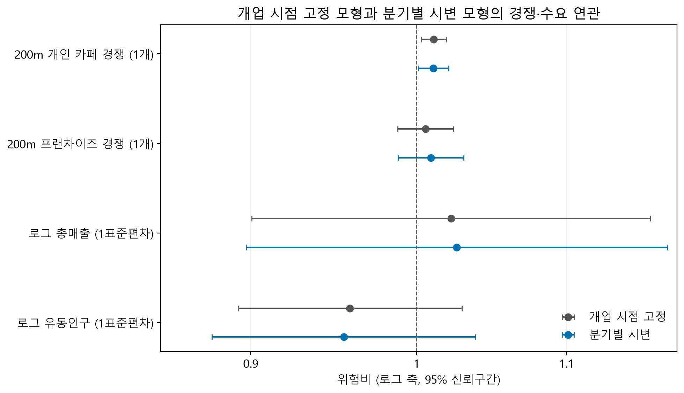
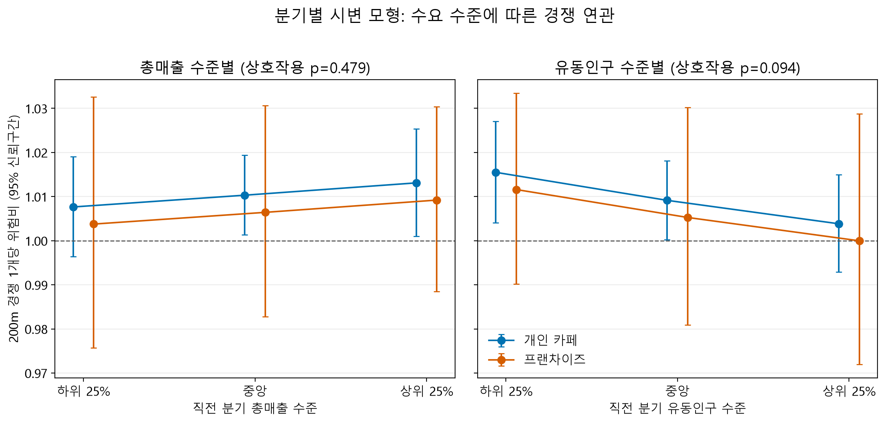
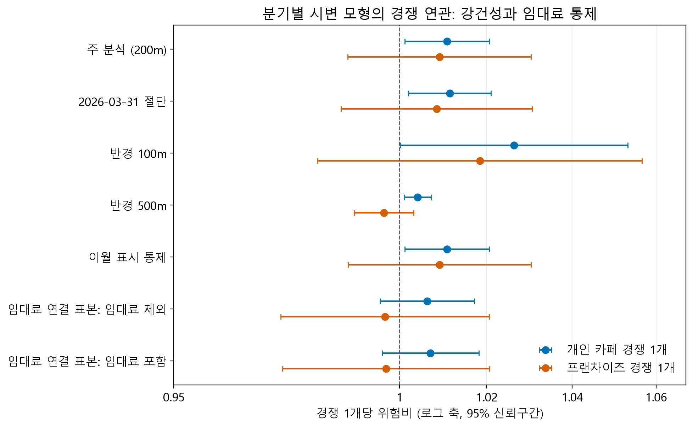

# 시변 Cox와 임대료 보조 분석 보고서

## 주요 결과

개업 시점의 값을 고정해 쓰는 대신, 분기마다 바뀌는 주변 경쟁과 직전 분기 상권값을 넣은 시변 Cox를 적합했다. 표본은 개인 카페 7,348개, 폐업 3,408건, 분기 구간 73,597행이다. 모든 모형은 개업연도로 층화하고 배정 상권 단위 군집 강건 표준오차를 썼다. 결과는 "연관된다" 수준으로만 해석한다.

### 결론 요약

| 질문 | 개업 시점 고정 주 분석(05) | 분기별 시변 모형(이번 분석) | 판단 |
|---|---|---|---|
| 개인 카페 경쟁 | 1개당 HR 1.011 (1.003–1.019) | 1개당 HR 1.011 (1.001–1.021) | **같음.** 강건성 세 가지에서 모두 유지 |
| 프랜차이즈 경쟁 | 1.006 (0.988–1.024), 강건하지 않음 | 1.009 (0.988–1.030) | **같음.** 연관을 확인하지 못함 |
| 수요(총매출·유동인구) | 신뢰구간이 1을 포함 | 신뢰구간이 1을 포함 | **같음.** 수요의 단독 연관은 없음 |
| 상쇄: 가려짐 | 수요를 넣어도 경쟁 계수 +0.1% | +15%(1.0076→1.0087) | 방향은 가려짐 쪽이지만 크기가 작음 |
| 상쇄: 유동인구 완충 | 상호작용 0.990, p=0.024 | 0.990, p=0.094 | **점추정은 같고 근거는 약해짐** |
| 개업 후 경쟁 변화 | — | 개인 1.004 (0.978–1.031) | 개업 당시 경쟁만 연관됨 |
| 임대료 | — | 1 로그 단위당 HR 0.88 (0.70–1.11) | 임대료를 넣어도 경쟁·수요 계수 거의 그대로 |

정리하면, 개업 후 경쟁과 상권 수요가 분기마다 바뀌는 것을 반영해도 **주 분석의 결론은 바뀌지 않는다.** 폐업 위험과 꾸준히 연관된 것은 반경 200m 안의 개인 카페 수다. 이 연관은 개업 이후 생긴 경쟁보다 개업 당시 주변에 이미 있던 개인 카페 수에서 나온다. 예비 창업자에게 "개업 시점 주변 개인 카페 수"가 가장 일관된 입지 판단 지표라는 해석을 이 분석이 뒷받침한다.

### 경쟁

시변 상권+점포 단위 경쟁 모형에서 200m 개인 카페 1개당 위험비는 1.011 (1.001–1.021, p=0.028)로, 개업 시점 고정 모형(1.011, 1.003–1.019)과 점추정이 같다. 신뢰구간은 조금 넓어졌지만 여전히 1을 넘는다. 프랜차이즈 경쟁은 1.009 (0.988–1.030, p=0.39)로 고정 모형처럼 연관을 확인하지 못했다.

수정 전 실행에서는 부트스트랩 5회로 프랜차이즈 신뢰구간을 1.000–1.018로 계산해 연관이 있는 것처럼 보였다. 군집 강건 표준오차로 다시 계산하니 그 구간은 0.988–1.030이었다. 따라서 이전 결과는 반복 수가 부족해 생긴 착시였다.

경쟁·수요 네 변수 모두 개업 시점 고정 모형과 분기별 시변 모형의 위험비가 거의 겹친다.

**개업 당시 경쟁과 개업 후 변화량을 나누면** 개업 당시 개인 카페 수가 1개 많을 때 위험비 1.011 (1.002–1.021, p=0.019)이다. 사분위 범위인 7개 차이로 환산하면 1.08이다. 반면 개업 후 개인 카페가 늘어난 양은 1개당 1.004 (0.978–1.031)였고, 프랜차이즈 증가량은 1.024 (0.970–1.081)였다. 둘 다 연관을 확인하지 못했다. 개업 후 변화량은 점포의 67%에서 0이 아니었지만 사분위 범위가 1개(중앙값 0, 표준편차 2.4)에 불과해 추정이 부정확하다. 그래서 "개업 후 경쟁 증가는 무관하다"고 단정하지는 않고, "개업 후 변화로는 추가 연관을 확인하지 못했다"고 서술한다.

### 수요와 상쇄

경쟁과 상권 구분에 수요를 함께 넣은 모형에서 직전 분기 로그 총매출 1표준편차당 위험비는 1.018 (0.909–1.139), 로그 유동인구는 0.948 (0.864–1.041)이었다. 수요의 단독 연관은 고정 모형처럼 확인되지 않았다.

- **가려짐**: 경쟁만 넣은 모형의 개인 카페 위험비 1.0076 (0.998–1.017)은 수요를 넣자 1.0087 (0.999–1.018)로 커졌다(계수 +15%). 수요가 많은 곳에 경쟁도 몰려 경쟁의 위험 연관을 일부 가린다는 방향이다. 다만 변화의 절대 크기가 작아 가려짐이 결론을 바꿀 정도는 아니다. 고정 모형에서는 이 변화가 +0.1%였다.
- **완충**: 전체 경쟁×유동인구 상호작용은 0.990 (0.979–1.002, p=0.094)으로 고정 모형(0.990, p=0.024)과 점추정이 같지만 신뢰구간이 1을 넘었다. 조건부 위험비로 보면 유동인구 하위 25% 상권에서 개인 카페 1개당 1.016 (1.004–1.027), 중앙에서 1.009 (1.000–1.018), 상위 25%에서 1.004 (0.993–1.015)였다. 유동인구가 많을수록 경쟁의 위험 연관이 약해지는 방향이 고정 모형과 같다. 총매출과의 상호작용은 1.004 (p=0.48)로 완충 근거가 없었다.

유동인구가 낮은 상권일수록 개인 카페 경쟁 1개당 위험비가 크고, 총매출 수준에 따라서는 뚜렷한 차이가 없다.

### 임대료

R-ONE 상권 임대료가 모든 분기에 연결된 하위 표본은 개인 카페 3,781개, 폐업 1,770건, 상권 587개다. 폐업 비율은 46.8%로 주 표본(46.4%)과 비슷하다. 그러나 R-ONE 조사 상권이 번화가 위주라서 발달상권 비중이 48%(주 표본 39%), 관광특구가 7%(주 표본 4%)로 높다. 개업 시점 200m 개인 카페 수의 중앙값도 9개로 주 표본(6개)보다 많다. 연결되지 않은 점포는 골목상권이 64%다.

같은 하위 표본에서 임대료를 넣기 전과 후를 비교했다.
- 개인 카페 경쟁: 1.006 (0.996–1.017) → 1.007 (0.996–1.018)
- 프랜차이즈 경쟁: 0.997 → 0.997
- 로그 총매출: 1.047 → 1.040
- 로그 유동인구: 0.913 → 0.932
- 직전 분기 로그 소규모 상가 임대료: 1 로그 단위(약 2.7배)당 0.880 (0.701–1.105, p=0.27)

임대료 자체의 연관은 확인되지 않았고, 임대료를 통제해도 경쟁·수요 계수는 거의 변하지 않았다. 이 하위 표본에서는 임대료를 넣기 전부터 개인 경쟁의 신뢰구간이 1을 포함한다. 이는 임대료 때문이 아니라 표본이 번화 상권 절반으로 줄고 구성이 다르기 때문이다. 로그 임대료의 표준편차가 0.32로 작아 점포 간 임대료 차이가 크지 않다는 점도 추정을 부정확하게 만든다. 임대료가 경쟁 연관을 설명한다는 근거는 없다는 정도로만 서술한다.

### 강건성

| 검증 | 표본 | 개인 카페 경쟁 HR | 프랜차이즈 경쟁 HR | 경쟁×유동인구 |
|---|---|---|---|---|
| 주 분석 (200m) | 7,348개, 3,408건 | 1.011 (1.001–1.021) | 1.009 (0.988–1.030) | 0.990, p=0.094 |
| 2026-03-31 절단(매출·점포 이월 구간 제외) | 7,344개, 3,067건 | 1.011 (1.002–1.021) | 1.009 (0.987–1.031) | 0.990, p=0.083 |
| 반경 100m | 같음 | 1.026 (1.000–1.053) | 1.018 (0.982–1.057) | 0.978, p=0.049 |
| 반경 500m | 같음 | 1.004 (1.001–1.007) | 0.996 (0.990–1.003) | 0.997, p=0.022 |
| 이월 표시 통제 | 같음 | 1.011 (1.001–1.021) | 1.009 (0.988–1.030) | — |

개인 카페 경쟁의 위험 연관은 네 검증에서 모두 유지됐다. 1개당 크기는 반경이 좁을수록 컸다(100m 1.026, 200m 1.011, 500m 1.004). 바로 옆 카페 하나가 먼 카페 하나보다 더 크게 연관된다는 뜻이다. 프랜차이즈 경쟁은 어느 검증에서도 연관을 확인하지 못했다. 유동인구 완충은 모든 검증에서 같은 방향이었고, 100m·500m에서는 p<0.05였다. 매출·점포 자료가 2025Q4에서 끝나 마지막 값을 이어 쓴 2026년 구간을 빼도(절단), 이월 여부를 통제해도 결과가 바뀌지 않았다.

개인 카페 경쟁의 위험비는 절단·반경·이월 통제에서 모두 1보다 크다. 임대료 연결 하위 표본에서만 신뢰구간이 1을 포함하는데, 이는 표본 구성 차이 때문이다.

## 방법과 검증

### 표본

시변 패널(`data/processed/cafes_quarterly_panel.parquet`)에서 개업 시점 Cox 주 분석 표본 7,351개를 골랐다. 그중 후속 구간에 상권값이 빠진 3개 점포(16개 구간)를 뺐다(`docs/tables/06_tv_cox_excluded_intervals.csv`).

- `3210000-104-2022-00287`, `3210000-104-2022-00305`: 같은 상권(3110946)에서 직전 분기 2022Q4~2025Q3 중 여러 분기의 유동인구가 비어 있다. 원자료 길단위인구 파일에 이 상권은 2021Q1~2022Q3, 2023Q1, 2025Q1의 9개 분기 행만 있다.
- `3180000-104-2024-00105`: 상권 3110793의 상주인구 원자료 행이 2024Q1에서 끝나 2024Q2 값이 없다.

세 점포는 모두 폐업했다. 결측 구간만 빼면 점포의 위험 집합이 중간에 끊기므로 점포 전체를 뺐다. 다른 처리 선택지는 직전 관측값을 이어 쓰는 것이다. 7,351개 중 3개라 결과에 미치는 영향은 무시할 수 있다고 보고 주 분석의 처리를 유지했다.

### 변수

각 분기 구간에는 그 구간 직전 분기의 상권 매출·인구·커피 점포 수와 그 분기의 반경별 경쟁 점포 수를 넣었다. 로그 총매출·로그 유동인구는 개업 시점 값의 평균·표준편차(총매출 23.21·1.84, 유동인구 13.88·1.03)로 표준화해 고정 모형과 단위를 맞췄다. 상권 구분은 골목상권 기준 더미로 넣었다. 개업연도 층은 2026년 사건이 30건 미만이라 2025년과 합쳤다. 개업 후 변화량은 각 구간 경쟁 수에서 개업 구간 경쟁 수를 뺀 값이다.

### 적합과 표준오차

각 분기 구간을 지연 진입 행으로 보고 `CoxPHFitter(duration_col="stop", entry_col="start", strata=개업연도 층, cluster_col=배정 상권, robust=True)`로 적합했다. 이 방식은 `CoxTimeVaryingFitter`와 같은 부분우도를 최대화한다. 시변 상권+점포 단위 경쟁 모형에서 두 방법의 부분 로그우도 차는 4.3e-10이었다. 계수 차는 최대 7.4e-6이었는데, 이 최댓값은 우도면이 평평한 상권 커피 점포 수 결측 표시 변수에서 나온 수렴 허용오차다. 그래서 두 방법을 같은 모형으로 판단했다.

수정 전 실행은 `CoxTimeVaryingFitter`가 군집 강건 분산을 지원하지 않아 상권 클러스터 부트스트랩을 5회(강건성·임대료 3회)만 반복했다. 이 반복 수로는 표준오차를 신뢰할 수 없어 부트스트랩을 폐기하고 모든 표준오차·신뢰구간·p값을 군집 강건 샌드위치 분산으로 바꿨다. 수요 수준별 조건부 위험비의 신뢰구간은 lifelines가 내부에서 계산한 샌드위치 공분산 행렬로 선형 결합 분산을 구해 만들었다. 이 행렬의 대각 성분이 lifelines 표준오차와 일치하는지 매 적합마다 확인했다.

Harrell's C는 시변 상권+점포 단위 경쟁 모형 0.533으로, 고정 모형(0.521)처럼 낮다. 경쟁·수요가 폐업 위험과 연관되기는 하지만, 개별 점포의 폐업을 예측하는 힘은 작다.

### 강건성과 임대료 표본

- 2026-03-31 절단: 매출·점포 파일이 2025Q4까지라 2026Q2 이후 구간은 마지막 값을 이어 썼다. 이 구간을 피하도록 2026-03-31에 행정 중도절단했다.
- 반경 100m·500m: 경쟁 변수와 상호작용 모두 해당 반경의 점포 수로 바꿨다.
- 이월 표시 통제: 매출·점포·인구 이월 표시 중 값이 변하는 것을 공변량으로 넣었다.
- 임대료 표본: R-ONE 소규모 상가 임대료(천원/㎡)가 연결되고 모든 구간에 직전 분기 임대료가 있는 점포만 썼다. 임대료는 자연로그로 넣었다.

### 산출물

- 계수: `docs/tables/06_tv_cox_coefficients.csv` (주 분석·강건성·임대료 전체), `06_tv_cox_robustness_coefficients.csv`, `06_tv_cox_rent_coefficients.csv`
- 가려짐: `docs/tables/06_tv_cox_competition_changes.csv`
- 완충 조건부 위험비: `docs/tables/06_tv_cox_demand_competition_hr.csv`
- 고정 모형 비교: `docs/tables/06_tv_cox_fixed_comparison.csv`
- 표본: `docs/tables/06_tv_cox_sample_flow.csv`, `06_tv_cox_excluded_intervals.csv`, `06_tv_cox_robustness_summary.csv`, `06_tv_cox_rent_sample_profile.csv`
- 그림: `docs/figures/06_tv_cox_fixed_vs_time_varying.png`, `06_tv_cox_competition_hr_by_demand.png`, `06_tv_cox_competition_robustness.png`

## 한계

- 시변 공변량도 입지 선택과 운영 역량 같은 관측되지 않는 요인을 제거하지 못한다. 경쟁이 폐업을 일으킨다고 해석하지 않는다.
- 개업 후 경쟁 변화량은 대부분 0~1개라 변동이 작아서, 변화의 연관을 정밀하게 추정하기 어렵다.
- 임대료는 R-ONE 조사 상권에 연결된 절반 표본에서만 볼 수 있고, 그 표본은 번화 상권에 치우쳐 있다. 골목상권 카페의 임대료 연관은 이 자료로 알 수 없다.
- 매출·점포 자료가 2025Q4까지라 2026년 구간은 마지막 값을 이어 썼다. 절단 검증에서 결과는 같았다.
