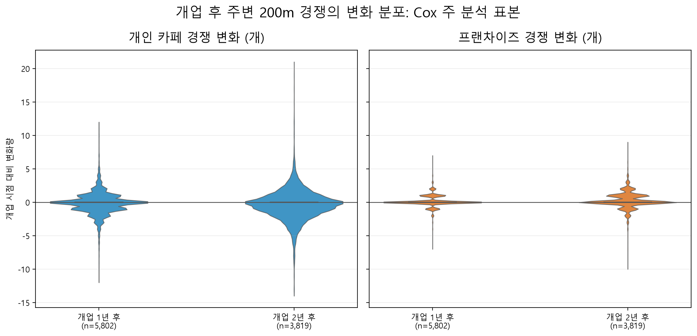
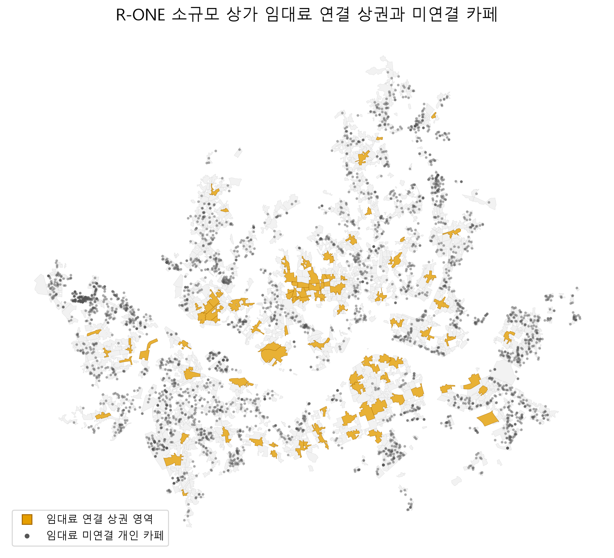

# 분기별 시변 패널·임대료 연결 보고서

## 주요 결과

개업기간 카페 전체 11,501개(프랜차이즈 포함)를 분기 start–stop 구간 121,752행으로 바꿨고, 고정시점 Cox 주 분석 표본은 7,351개로 표시했다. 주 분석 표본 구간은 73,621행이다.
200m 전체 경쟁은 좌표가 있어 비교 가능한 11,294건에서 개업 첫 구간과 기존 고정시점 값이 모두 일치했다(불일치 0건). 이는 첫 구간 경쟁 산출이 기존 개업일 경쟁 변수와 같은 시점·후보 규칙을 재현했음을 뜻한다.
개업 시점 대비 이후 200m 전체 경쟁 변화는 개업 1년 후 중앙값 +0.0개 (증가 2,976건, 감소 3,144건, n=9,207); 개업 2년 후 중앙값 +0.0개 (증가 2,267건, 감소 2,601건, n=6,398)이다. 세부 개인·프랜차이즈별 변화 분포는 `06_panel_opening_comparison.csv`에 저장했다.
R-ONE 임대료는 5,952개 점포에 연결됐다. 자동 확정과 검토 대응표를 합쳐 67개 R-ONE 권역을 94개 상권 영역에 연결했고, 자동 결과와 검토 결과가 상충한 권역은 0개였다. 따라서 임대료가 연결된 표본은 보조 분석용으로만 해석해야 한다.

개업 후에도 개인·프랜차이즈 경쟁 수가 양방향으로 바뀌어, 개업 시점 값만으로 이후 경쟁 환경을 대표하기 어렵다.

검토 대응표로 연결된 상권은 주요 상업지에 집중되며, 미연결 개인 카페 위치가 남아 있어 임대료 분석은 연결 하위 표본으로 제한한다.

## 방법과 검증

점포별로 개업일부터 해당 개업 분기 말까지를 첫 구간으로 하고, 이후 분기 경계에서 나눴다. 마지막 구간은 폐업일 또는 2026-09-30 관측 종료일에 끝난다. `start`·`stop`은 개업 후 일수이며, 사건은 마지막 구간에만 부여했다.
경쟁은 각 구간 시작일 전에 개업하여 그 시점에 영업 중인 `cafes_clean.parquet`의 카페만 대상으로 EPSG:5181에서 100m·200m·500m 반경을 세었다. 본인 인허가와 비카페 업종은 제외했고, 개인·프랜차이즈·합계를 각각 저장했다. 따라서 미래 개업·폐업 정보가 공변량에 들어가지 않는다.
상권 매출·점포·유동인구·상주인구는 기존 상권 원자료 집계 함수를 이용해 분기별로 다시 만들고, 구간 시작 직전 분기 값을 배정했다. 해당 분기의 값이 없으면 같은 상권의 마지막 관측값만 앞으로 이월했으며, 매출·점포·인구 이월 여부를 별도 열로 기록했다. 2026-03-31 이후에도 관측을 끊을 수 있도록 원자료가 없는 매출·점포 값의 이월을 보존했다.
R-ONE CSV는 CP949 및 3행 헤더를 확인해 권역·분기·상가유형·임대료(천원/㎡) 형태로 정리했다. 자동으로 하나로 확정된 28개 권역에 Claude 검토 대응표의 39개 권역을 더했으며, 한 R-ONE 권역이 여러 상권 영역에 대응하는 경우에는 모두 같은 임대료를 붙였다. 서울·도심·강남·영등포신촌·기타 같은 상위 집계 행과 양재말죽거리는 연결하지 않았다. 배정 상권이 연결된 경우 직접 연결하고, 그렇지 않으면 연결 상권 폴리곤 500m 이내 최근접인 경우만 연결했다.

### 검증

구간 종료시간=원래 생존기간 검증 실패 0건, 구간 사건합 검증 실패 0건이다. 전체 검증표는 `06_panel_validation.csv`에 있다.

## 산출물

- `data/processed/cafes_quarterly_panel.parquet`
- `data/processed/rent_rone_quarterly.parquet`
- `docs/review/06_rent_area_mapping.csv`
- `docs/tables/06_panel_*.csv`
- `docs/figures/06_panel_competition_change.png`
- `docs/figures/06_panel_rent_linkage_map.png`

## 제한과 결정이 필요한 사항

R-ONE 권역은 상권분석서비스 상권 폴리곤과 공식 경계·코드 대응표가 없어, 검토 대응표에 없는 권역은 여전히 이름으로 하나로 확정된 경우만 연결했다. 연결 하위 표본의 대표성 또는 임대료의 인과적 효과는 주장하지 않는다.
