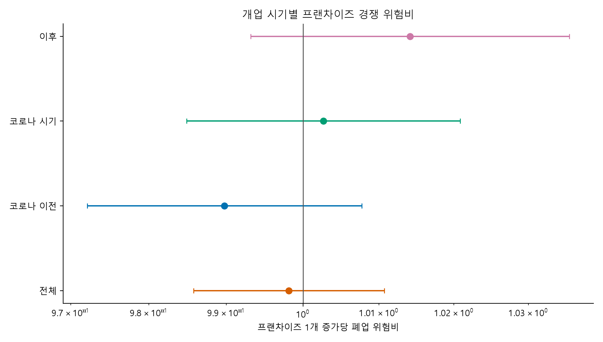
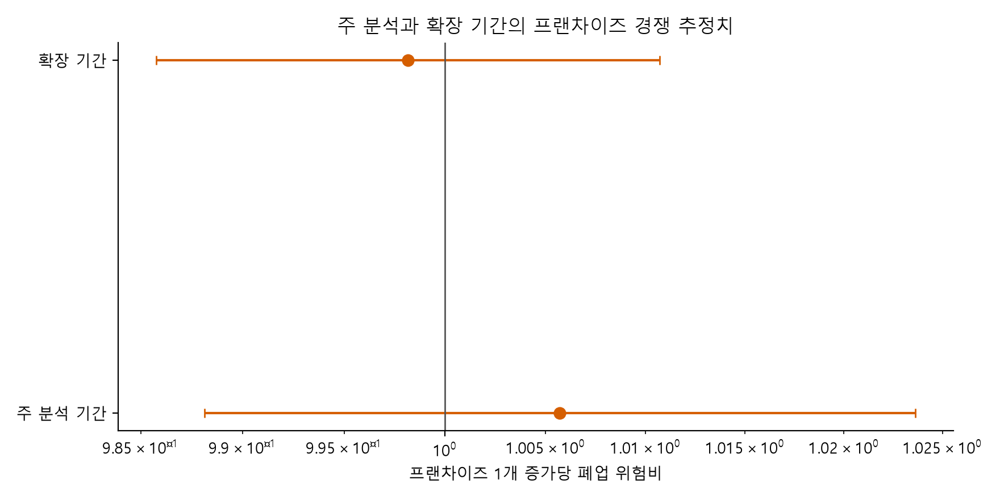
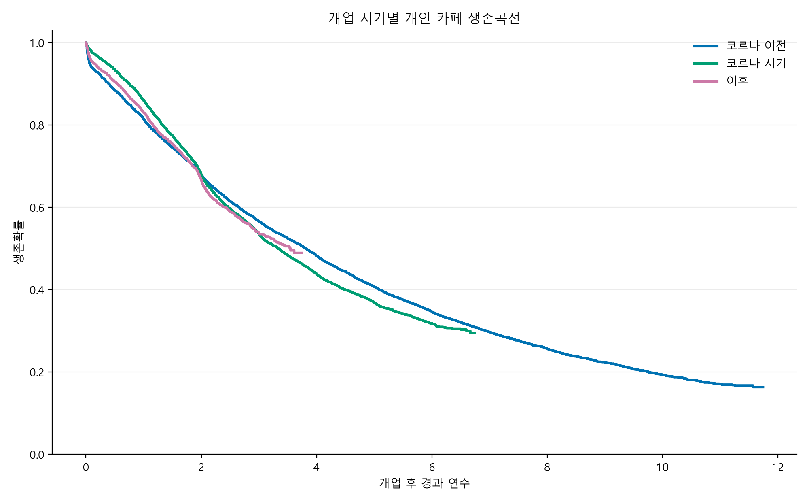

# 확장 기간 프랜차이즈 경쟁 분석

## 한 줄 결론

2015년부터 2026년 1분기까지 개업한 개인 카페 19,276개(폐업 12,480건)를 보면, 200m 안 개인 카페가 많을수록 폐업 위험은 조금 높게 관련됐지만(HR 1.020, 95% CI 1.000–1.040), 프랜차이즈 수는 위험을 높이거나 낮춘다는 뚜렷한 관련이 없었다(HR 0.998, 95% CI 0.986–1.011). 다만 같은 건물·단지 상가로 보이는 10m 이내 결과는 주의해서 볼 신호다.

## 무엇을 알게 되었나

### 기간을 넓혀도 개인 카페 경쟁 결론이 유지되는가

유지된다. 확장 표본 전체에서 200m 안 개인 카페가 1개 더 있을 때 폐업 위험은 2.0% 높게 관련됐다(HR 1.020, 95% CI 1.000–1.040). 개업 시기별로도 코로나 이전은 HR 1.030 (1.002–1.059), 코로나 시기는 1.004 (0.995–1.013), 이후는 1.014 (1.001–1.027)였다. 코로나 이전과 비교하면 코로나 시기의 관련은 더 약했다(상호작용 HR 0.984, p=0.042). 이후 시기의 차이는 뚜렷하지 않았다(상호작용 HR 0.988, p=0.220). 코로나 시기 개업에서 관계가 약하게 추정된 것은 사실이지만, 이 자료만으로 그 이유를 정할 수는 없다. 영업제한·상권 변화·신규 진입 구성의 변화 등이 가능한 설명일 뿐이다. 2020년 개업은 코로나 시기에 포함했다.

개업 후 1년 이내(HR 1.032, 1.001–1.064), 1~3년(HR 1.009, 1.002–1.016), 3년 이후(HR 1.009, 1.001–1.018)에도 개인 카페 경쟁은 같은 방향이었다. 거리를 나누면 이 관련은 0~100m에서 보였고(HR 1.053, 1.007–1.101), 100~200m에서는 뚜렷하지 않았다(HR 0.992, 0.976–1.009).

주 분석 기간만 같은 기본 확장 사양으로 다시 적합하면 개인 카페 1개당 HR은 1.011 (1.001–1.020)이다. 전체 확장 표본의 1.020과의 차이는 수요 통제의 유무가 아니라, 2015년부터의 더 오래된 개업 코호트와 그 관측기간을 추가한 데서 나온 차이다.

### 프랜차이즈 근처를 피해야 하는가

그렇게 권할 근거는 아직 없다. 200m 안 프랜차이즈 1개 증가는 폐업 위험과 거의 관련이 없었다(HR 0.998, 95% CI 0.986–1.011). 신뢰구간의 가장 높은 값 1.011도 확장 표본에서 개인 카페 1개당 추정치 1.020보다 작다. 즉 이 자료에서 프랜차이즈 한 곳의 가장 나쁜 경우조차 개인 카페 한 곳과 같은 크기의 위험 증가로 보이지는 않는다.

유형별로 저가 커피는 HR 1.027 (0.996–1.059, p=0.089)로 위험을 높이는 쪽으로 기울지만 확정은 아니다. 대형 커피는 0.995 (0.966–1.025), 음료는 1.041 (0.958–1.132), 기타 커피는 0.915 (0.822–1.019)로 모두 신뢰구간이 1을 포함했다. 프랜차이즈를 0~100m와 100~200m로 나누어도 각각 HR 1.008 (0.988–1.029), 0.978 (0.949–1.009)로 뚜렷한 관련이 없었다.

그림은 전체와 세 개의 개업 시기 모두에서 프랜차이즈 1개당 신뢰구간이 기준선 1을 지나, 시기별로도 뚜렷한 위험 증가·감소를 확인하기 어렵다는 것을 보여 준다.

그림은 주 분석과 확장 기간 모두 프랜차이즈 경쟁 추정치가 기준선 가까이에 있고, 확장 기간 쪽 신뢰구간이 더 좁아졌음을 보여 준다. 두 모형은 수요 통제 구성이 달라 추정치 차이를 원인 효과의 변화로 해석하지 않는다.

### 바로 옆·같은 건물 프랜차이즈는 어떤가

가장 가까운 프랜차이즈까지의 거리가 멀수록 위험은 낮게 추정됐다. `log(1+거리)` 모형을 거리 두 배로 풀면, 일반적인 거리 범위에서 두 배 멀어질 때 폐업 위험은 약 3.4% 낮았다(HR 0.966, 95% CI 0.934–0.998). 다만 이 추정은 여러 프랜차이즈 지표를 함께 검정한 결과 중 하나이므로 p=0.040 수준의 주의 신호로만 해석한다.

10m 이내에 프랜차이즈가 있는 개인 카페는 표본의 13.7%(2,650/19,276)였고, 이 경우 폐업 위험은 더 높게 관련됐다(HR 1.257, 1.008–1.568, p=0.042). 10m 이내 개인 카페가 있는 경우도 23.6%(4,552/19,276)이며 HR은 1.093 (1.007–1.185)이었다. 주소 예시에는 경희궁의아침 단지 상가, 르메이에르종로타운, 종로타워처럼 같은 좌표를 쓰는 대형 건물·단지 상가가 여럿 보인다. 따라서 10m 이내는 실제 바로 옆 점포라기보다 같은 건물 또는 같은 단지 상가를 뜻할 가능성이 크며, 대형 상가·오피스 같은 건물 유형의 차이가 결과에 섞였을 수 있다. 이 때문에 같은 자리 프랜차이즈의 p≈0.04 결과도 회피 판단의 근거가 아니라 추가 확인이 필요한 주의 신호다.

### 소규모 체인 분류가 결론을 바꾸는가

기타 커피 소규모 체인을 개인 카페로 다시 분류해도 결론은 바뀌지 않았다. 확장 표본은 20,302개(폐업 13,008건)로 늘었고, 개인 카페 경쟁은 HR 1.017 (1.000–1.034), 프랜차이즈 경쟁은 1.002 (0.989–1.015)였다. 주 분석 기간에서도 각각 1.010 (1.002–1.018), 1.008 (0.988–1.028)이었다. 즉 분류를 바꿔도 개인 카페 경쟁의 작은 양의 관련과 프랜차이즈의 불확실한 관련이라는 요지는 유지된다.

2021년 1분기 상권 매출·유동인구·상주인구 스냅샷을 붙인 보조 모형도 기본 모형과 같은 결론이었다. 개인 카페는 HR 1.020 (1.002–1.038), 프랜차이즈는 0.994 (0.977–1.011)였다.

그림은 코로나 이전 개업과 코로나 시기 개업의 관측된 5년 생존확률이 각각 40.8%, 36.9%임을 보여 준다. 이후 개업 코호트는 5년 추적기간이 아직 충분하지 않아 이 두 코호트와 직접 비교할 수 없으며, 이 곡선은 경쟁 효과를 뜻하지 않는 기술적 결과다.

## 방법과 검증

원본 정제본에서 2015-01-01~2026-03-31 개업 기록을 선택했다. 임시 인허가, 생존기간 0일 이하, 비카페, 폐업 상태인데 폐업일이 없는 기록의 처리 기준은 기존 정제와 같으며, 연도별 점검에서 폐업 상태인데 폐업일이 없는 건은 모두 0건이었다. 좌표 결측률은 개업연도별 0.35~2.65%였다. 연도별 점포 수·폐업 수·좌표 결측률·생존기간 분포는 `07_extended_data_quality.csv`, 최종 표본 흐름은 `07_extended_sample_flow.csv`에 있다.

경쟁 점포는 개업일보다 앞서 개업했고 그 날 영업 중인 점포만 세었다. 2021Q2~2026Q1 겹침 표본에서 개인·프랜차이즈 200m 수가 기존 `cafes_analysis.parquet`와 점포별로 일치하고, 유형합·거리구간합이 200m 합계와 일치함을 확인했다. 모든 불일치 수는 `07_extended_validation.csv`에서 0이다. 2km 안에 프랜차이즈가 없는 경우 최근접 거리는 2km로 절단하고 `fran_within_2km`에 표시했다.

기본 모형은 개업연도 층화 Cox, 배정 상권 군집-강건 표준오차를 사용했다. 공변량은 200m 개인·프랜차이즈 경쟁, 상권 구분, 그리고 개업 시점 인허가 자료로 계산한 500m 전체 카페 수다. 2021년 이전에는 개업 직전 상권 수요자료가 없으므로 기본 모형에 넣지 않았다. 보조 모형의 2021Q1 상권 스냅샷은 2021년 이전 개업 점포에는 개업 뒤 정보이므로, 기본 결과를 확인하는 용도로만 사용했으며 인과 해석에는 쓰지 않았다.

## 산출물

- 확장 표본: `data/processed/cafes_extended.parquet`
- 표: `docs/tables/07_extended_*.csv`
- 그림: `docs/figures/07_extended_*.png`
