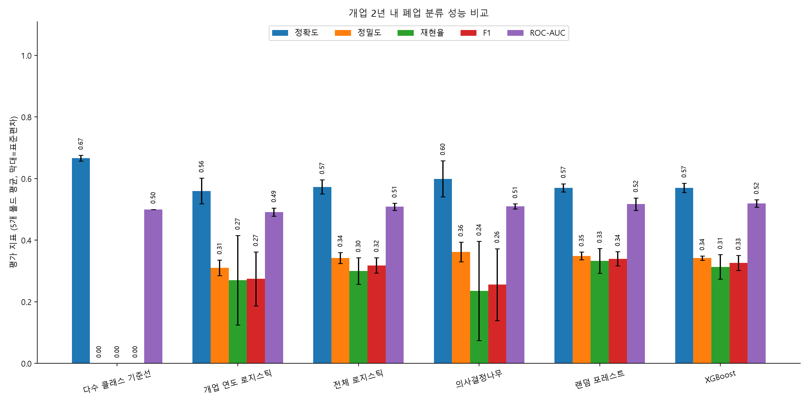
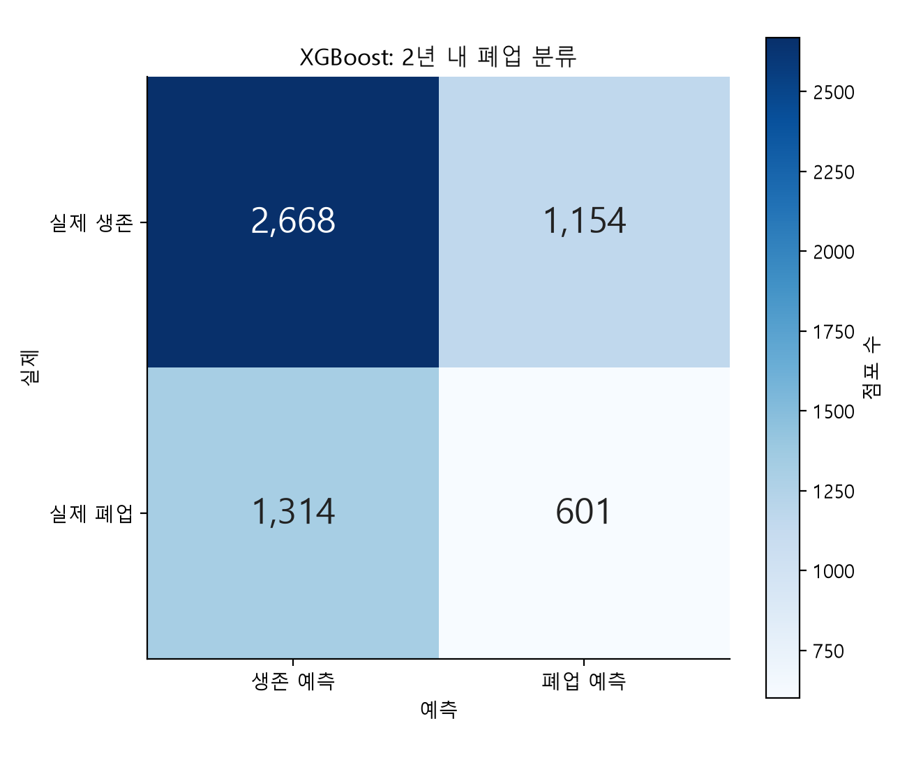
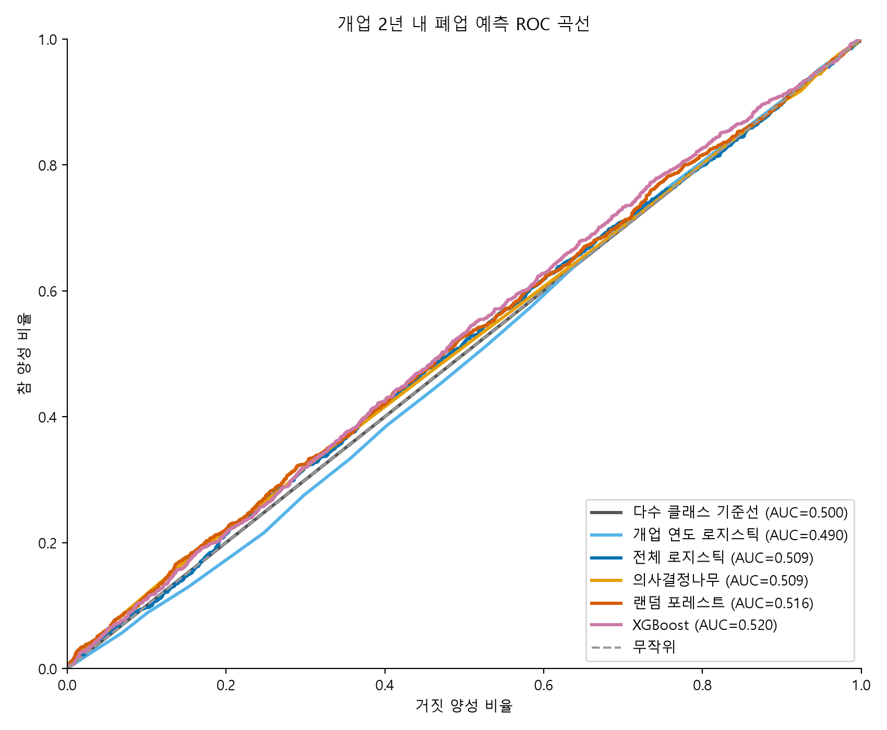
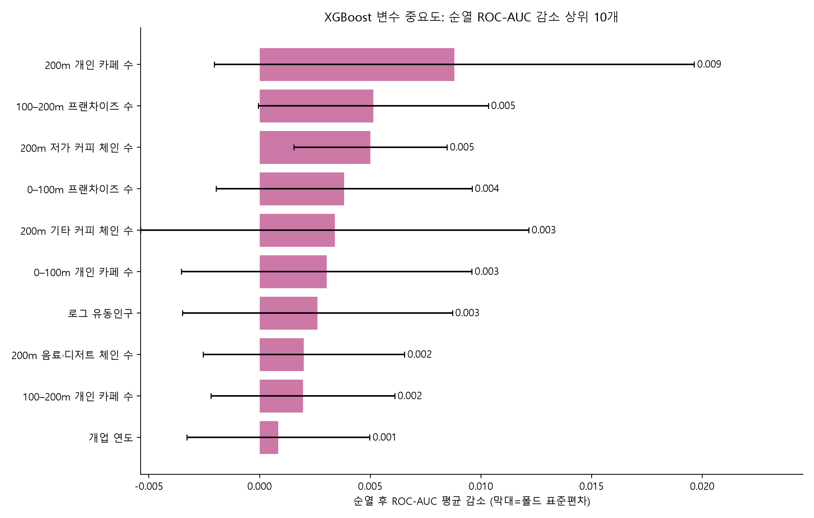

# 개업 2년 내 폐업 분류 모형 비교

## 분석으로 알게 된 점

개업 시점의 입지·경쟁 정보를 사용해 개인 카페의 **개업 후 2년 이내 폐업 여부**를 분류했다. 관찰 창이 완결된 표본은 5,737개이며, 2년 내 폐업은 1,915개(33.4%)다.

주 결과에서는 각 학습 폴드의 실제 폐업 비율만큼 예측 점수가 높은 점포를 폐업으로 분류했다. 따라서 모든 모형이 대체로 같은 예측 폐업 비율에서 정확도·정밀도·재현율·F1을 비교한다. ROC-AUC 평균이 가장 높은 모형은 **XGBoost**이며, 정확도 0.570±0.015, 정밀도 0.342±0.007, 재현율 0.314±0.040, F1 0.326±0.024, ROC-AUC 0.519±0.012다. ROC-AUC가 0.5에 가까워 개업 시점 정보만으로 개별 점포의 2년 내 폐업을 강하게 구분한다고 보기는 어렵다.

부록의 OOF F1 최대 기준에서 XGBoost의 F1은 0.500±0.010이다. 이 기준은 낮은 임계값에서 거의 모든 점포를 폐업으로 분류하는 방향으로 치우칠 수 있어 주 비교 기준으로 쓰지 않았다. 고정 0.5 기준도 제공하며, XGBoost에는 매 학습 분할에서 `scale_pos_weight=생존 수/폐업 수`를 적용했다.

변수 중요도는 순열 ROC-AUC 감소를 주 지표로 제시한다. 평균 감소가 가장 큰 변수는 **200m 개인 카페 수**(0.009), 다음은 **100–200m 프랜차이즈 수**(0.005)다. 대부분의 변수에서 평균 감소가 폴드 간 표준편차보다 작아 모형의 구분력이 낮고 변수 순위도 불안정하다. 평균 |SHAP|은 보조 지표로 표에만 수록했다.

그림은 학습 폴드의 폐업 비율을 맞춘 기준값에서의 5개 검증 폴드 평균 성능과 표준편차다.

그림은 ROC-AUC가 가장 높은 모형의 모든 검증 폴드 예측을 합친 결과다.

그림은 임계값과 무관한 점수 순위의 구분력을 비교한다.

그림은 XGBoost에서 변수를 섞었을 때의 ROC-AUC 평균 감소와 폴드 간 표준편차를 보여 준다.

## 방법과 검증

`05_cox.py`의 표본 준비 함수와 `08_survival_ml.py`, `05_cox_franchise_types.py`의 개업 시점 경쟁 변수 계산을 재사용했다. 모든 공변량은 개업 시점 또는 직전 분기의 값이며 개업 후 정보는 사용하지 않았다. 상권 코드가 같은 점포가 학습과 평가에 나뉘지 않도록 5개 GroupKFold를 사용했다.

각 외부 평가 폴드의 주 임계값은 훈련 자료의 그룹 OOF 예측확률에서 `1 − 훈련 폐업비율` 분위수로 정해 평가 폴드에 적용했다. 동점 확률이 많은 모형은 정확히 같은 예측 비율을 맞추지 못할 수 있으므로 실제 예측 폐업비율도 표에 기록했다. 다수 클래스 기준선은 그대로 최빈 클래스(생존)를 예측한다.

하이퍼파라미터는 사전 점검에서 중첩 격자 탐색이 과도하게 오래 걸려 고정했다. 전체 로지스틱(C=1), 의사결정나무(깊이 4·말단 최소 20), 랜덤 포레스트(150개·깊이 8·말단 최소 20), XGBoost(200개·깊이 3·학습률 0.05)를 적용했다. XGBoost 가중치는 외부 학습 분할과 OOF의 내부 학습 분할마다 독립적으로 다시 계산했다.

랜덤 포레스트와 XGBoost의 순열 ROC-AUC 감소를 중요도의 주 지표로, XGBoost 평균 |SHAP|을 보조 지표로 저장했다. 상세 성능·폴드별 임계값·F1 최대 및 0.5 부록·표본 흐름은 `docs/tables/08_clf_*.csv`에 수록했다.
