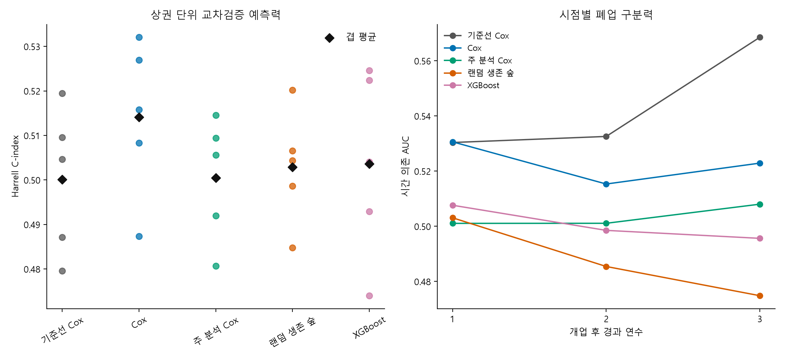
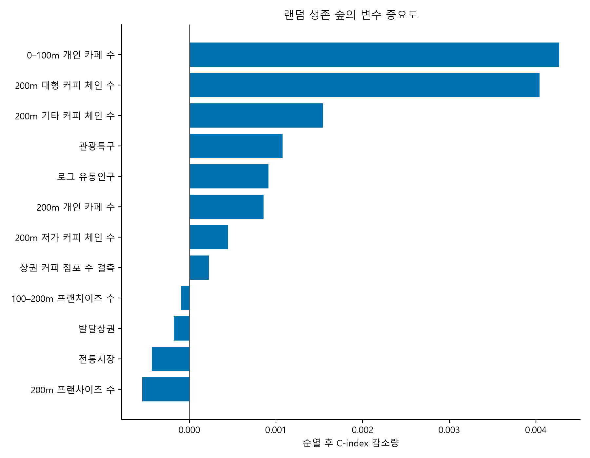
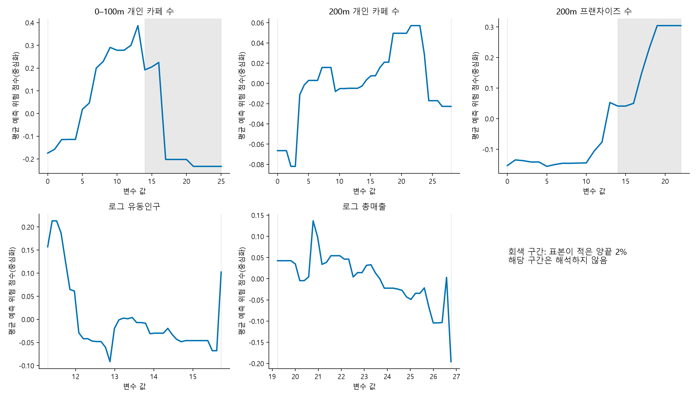
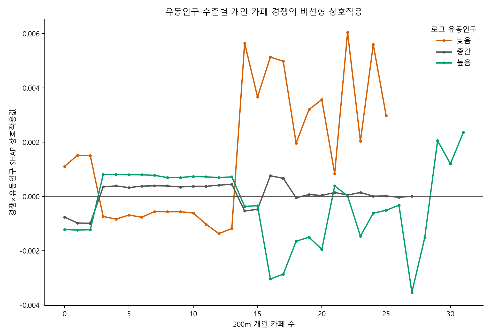

# 머신러닝 생존 모형으로 확인한 개업 입지와 카페 폐업

## 무엇을 확인했나

이 분석은 더 복잡한 모형이 입지 정보만으로 폐업을 얼마나 구분하는지, 그리고 Cox 분석에서 보인 개인 카페 경쟁의 연관이 다른 모형에서도 중요한지 확인하기 위해 수행했다. 개인 카페 7,351개와 폐업 3,411건을, 같은 상권의 점포가 학습과 평가에 섞이지 않도록 배정 상권 단위 5겹 교차검증으로 평가했다.

## 입지 정보로 폐업을 얼마나 구분할 수 있나

랜덤 생존 숲의 평균 Harrell C-index는 0.503 (겹 표준편차 0.013), XGBoost는 0.504 (0.021)였다. 같은 입지 정보를 선형으로 넣은 Cox는 0.514, 개업 연도만 쓴 기준선은 0.500였다. 복잡한 모형이 Cox보다 큰 폭으로 개선되지 않았고, C-index도 0.5에 가까웠다. 즉 **더 복잡한 모형을 써도 개업 시점의 입지 정보만으로는 어떤 점포가 폐업할지 잘 맞히지 못한다.** 입지는 폐업과 연관된 일부 조건일 수 있지만, 운영·자금·상권 변화처럼 이 자료에 없는 요인도 중요하다는 뜻이다.

1·2·3년 시간 의존 AUC는 랜덤 생존 숲에서 각각 0.503, 0.485, 0.475, XGBoost에서 0.508, 0.499, 0.496였다. Uno C와 통합 Brier 점수도 표에 함께 제시했다. Uno C의 절단 시점은 각 학습 겹 관측기간의 90% 분위수와 평가 겹 최장 관측기간 중 작은 값으로 정해, 관측 종료일 근처에서 절단 가중치가 불안정해지는 것을 피했다.

그림은 상권을 통째로 분리해도 모형 간 예측력 차이가 크지 않음을 보여 준다.

## 어떤 입지 변수가 중요한가

평가 겹에서 순열한 뒤 C-index가 가장 많이 낮아진 변수는 0–100m 개인 카페 수, 200m 대형 커피 체인 수, 200m 기타 커피 체인 수였다. 변수 중요도는 예측에 쓴 정보의 상대적 기여일 뿐, 폐업의 원인이나 효과 크기를 뜻하지 않는다. 특히 200m 총수·거리 구간·유형별 수는 같은 경쟁 정보를 겹쳐 표현한 변수도 있으므로, 중요도가 이들 사이에 나뉠 수 있다.

그림은 평가용 점포에서 변수를 섞었을 때의 C-index 감소량을 보여 준다.

## 경쟁의 모양과 유동인구 완충

부분 의존 그림에서 개인 카페 수가 늘어날수록 예측 위험 점수가 단조롭게 커지는지, 특정 수에서 급격히 꺾이는지는 뚜렷하지 않았다. 양끝 2% 구간은 표본이 적어 회색으로 표시했고 해석하지 않았다. 따라서 Cox의 선형 연관을 강한 임계값이나 비선형 효과로 바꿔 말할 근거는 없다.

그림은 XGBoost가 포착한 평균 예측 위험 모양이며, 회색 양끝은 해석 대상에서 제외한다.

유동인구 수준별 SHAP 상호작용 그림에서 개인 카페 수와 상호작용값의 단순 상관은 0.032이었다. 이 값만으로 유동인구가 경쟁 위험을 완충한다고 확정할 수는 없다. 주 분석 Cox의 경쟁 합계×로그 유동인구 위험비 0.990 (p=0.024)과 비교하면, 머신러닝에서도 완충 방향이 일관적인지 제한적으로만 살필 수 있으며, 비선형 상호작용의 강한 증거로 해석하지 않았다.

그림은 XGBoost의 SHAP 상호작용값을 유동인구 3분위별로 평균낸 것으로, 인과 효과가 아니다.

## 방법과 검증

주 분석과 같은 개인 카페·최근접 상권 200m 이내·완전 사례 표본을 사용했다. 로그 총매출·로그 유동인구·로그 상주인구, 상권 구분, 상권 커피 점포 수와 결측 표시, 200m 경쟁, 개업 연도를 넣고, 프랜차이즈 유형별 200m 수와 개인·프랜차이즈 거리 구간 수도 개업일 시점에 영업 중인 점포만 세어 추가했다. 유형별 합계와 거리 구간 합계가 기존 200m 경쟁 수와 점포별로 일치하는지 확인했다.

중첩 생존 숲 격자는 실행 환경의 메모리를 과도하게 사용해 첫 겹을 완료하지 못했다. 따라서 얕은 랜덤 생존 숲(60개 나무, 말단 최소 15개)과 깊이 2의 XGBoost라는 보수적 고정값을 모든 겹에 동일하게 적용했다. 이는 예측력 최적화가 아닌 Cox 결과 확인이라는 목적에 맞추고, 선택값은 표에 남겼다. 같은 총수를 유형·거리 구성요소가 정확히 합산하므로, Cox 비교모형에서는 식별 불가능한 중복을 피하기 위해 총수를 구성요소로 대체했다(정보는 동일). 주 분석 Cox는 기존과 같은 개업연도 층화 모형으로 별도 평가했다. 생존 확률이 필요한 Brier 점수에서 XGBoost는 학습 겹의 Breslow 기준위험으로 보정했다.

상세 성능·겹별 값·하이퍼파라미터·변수 중요도는 표 파일에 수록했다. 이 분석은 관찰자료의 연관을 보며, 경쟁·수요·상쇄를 인과적으로 판정하지 않는다.
